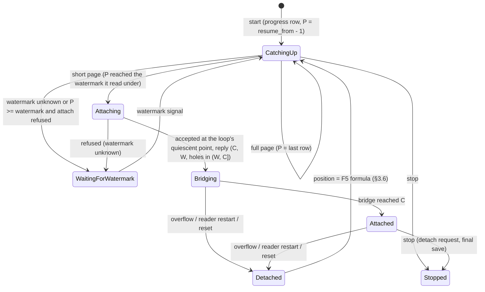

# Event store redesign, phase 3: engine design

**Status:** decided 2026-11-15 (§6); being built on `feature/event-store-engine-phase3`. When phase 3 is done, this file moves to
`docs/archive/` or is folded into the redesign's record (`docs/plans/README.md`).
**Scope:** phase 3 of `docs/plans/event-store-subscription-redesign.md` (§18, "Phases 1 onward"): one shared tail
reader per aggregate type per `EventLog` (§6), attach and detach with the bridge read (F3), overflow and the F5 resume
position, catch-up reads (§10, unfiltered and uncapped; filtering and the per-database cap are phase 5), the restarted
reader rule (F4) for attached subscriptions. `FRESH` only; `CONTIGUOUS` is phase 4. Backstop wake-up only. **Gate:** I9
passes; idle statements flat in the number of subscriptions; statements per delivered event at or below the P0.0
baseline with 10 subscriptions (decided 2026-11-15). I1-I4, I10 and I11 keep passing.

Section references (§n) are to the plan; "phase-2 §n" is `docs/plans/event-store-engine-phase2.md`. Where this draft
proposes something the plan does not say, it is marked **Proposed**. The existing `PostgresqlEventStore` and its
subscriptions are not changed, and nothing below copies their design; the public subscription API stays phase 8's
(§12.3), so phase 3 keeps the API it touches to what phase 2 already exposes and adds nothing public.

---

## 1. Types, threads and ownership

### 1.1 What changes from phase 2

Phase 2 gives every `FreshSubscription` its own `TailReader`, its own pooled connection held for its lifetime, and one
platform thread that reads and then runs the handler (phase-2 §6.1: idle statements grow with subscriptions, and the
pool must be larger than the number of subscriptions). Phase 3 separates the reader from the subscriptions.

| Type | Phase 3 | One line |
|---|---|---|
| `ReaderLoop` | New, package-private | One per `EventLog`: one platform thread, one connection, a `TailReader` per active aggregate type, the attached subscriptions per type, a request queue. **Proposed** (Q1): one thread and connection for all types rather than one per type |
| `TailReader` | Changed | Still the per-type state machine of phase 2 (cursor, holes, ranges, pending hole reads, candidates, watermark F2), still single-threaded. No longer opens or owns a connection: it is handed the loop's. `start(resumeFrom)` becomes `startAtHead()` (§2.4) |
| `Batch` | New record | `(List<StoredEvent> rows, long watermark)`: one read's published rows in `global_order` order, and the watermark after that read. Immutable; the same instance goes to every attached subscription |
| `Inbox` | New, package-private | A subscription's bounded buffer of batches: single producer (the loop thread), single consumer (the delivery thread), lock plus condition. Non-blocking `offer`; `close(reason)` |
| `HandledSet` | New, package-private | What a subscription has handled: a prefix `P` (every existing order ≤ `P` handled) plus a run-length set of handled orders above `P` (§3.2) |
| `FreshSubscription` | Rewritten inside, same public surface | Lifecycle state machine (§3.1), catch-up and bridge reads, delivery on its own virtual thread, progress saves. `EventLog.subscribe(…)` and the public methods (`stop`, `isRunning`, `wakeUp`, …) keep their phase-2 signatures, so the phase-8 API is not pre-empted |
| `EventLogSettings` | Two fields added | `subscriptionBufferSize` (events, default 1 000, must be ≥ `tailPageSize`), `catchUpPageSize` (default 500, also the bridge page) |
| `EventLogStorage.TailStatements` | Three statements added | `rangeRead`, `bridgePage`, `bridgePageWithRanges` (§4.1) |
| `TestSeams`, `WatermarkMutant` | Extended | The hooks and must-fail mutants of §5 |
| `EventLogObserver` | Extended | `onAttach`, `onDetach(reason, position)`, `onCatchUpRead`, inbox depth |

### 1.2 Threads

| Thread | Kind | Count | Runs |
|---|---|---|---|
| Reader loop | Platform, daemon, `eventlog-reader` | One per `EventLog` while any subscription exists | Reads due aggregate types, publishes batches, processes attach/detach/type requests at its quiescent point (§2.2) |
| Delivery | Virtual, `eventlog-<type>-<subscriber>` | One per subscription, never shared (§6) | Catch-up and bridge reads, the handler, retries, progress saves, detach handling |

A virtual thread for delivery is safe with a handler that does JDBC: on JDK 25, `synchronized` no longer pins the
carrier (JEP 491), and pgjdbc's I/O uses `ReentrantLock`. The reader loop stays a platform thread: it is one thread,
long-lived, and latency-sensitive, as the queue's reader is.

### 1.3 Who owns which state

§6: "Cursor, candidate list, hole set and watermark are touched by one thread only." Phase 3 keeps that and adds an
owner for every other piece:

| State | Owner (the only writer) | How others see it |
|---|---|---|
| Each `TailReader`'s cursor, holes, ranges, pending hole reads, candidates, watermark; its prepared statements | Loop thread | The immutable `TailReader.State` snapshot published at the end of each read (volatile, as phase 2); a per-type "watermark changed" signal |
| The attached list of each type; the loop's connection | Loop thread | Nobody; changes only through the request queue |
| Request queue (attach, detach, add type, remove type, wake) | Many producers, loop thread consumes | `ConcurrentLinkedQueue` plus a wake of the loop |
| `Inbox` contents | Loop thread offers, delivery thread takes | Lock-protected; `offer` never blocks |
| `HandledSet`, received watermark `W_rcv`, local pending batch, catch-up and bridge positions, reset epoch, last saved point | Delivery thread | `lastSaved()` and a published state for tests |

A debug-mode assertion in `TailReader` (owner thread recorded at `startAtHead`, checked on every entry point under
`-ea`, which the tests run with) makes a violation of the first row fail loudly instead of producing the queue's §9.23
duplicate.

---

## 2. The reader loop

### 2.1 One thread and one connection for all aggregate types

The plan says "one tail reader per aggregate type per JVM" (§6) and P0.16 decided that all woken aggregate types are
read in one flush, which needs one connection for all of them. **Proposed:** the *logical* reader stays one per
aggregate type (one `TailReader` state machine each), and one `ReaderLoop` thread and connection serves all of them.

- **Connections.** One held connection per `EventLog` instead of one per aggregate type. An application with 20
  aggregate types and 10 JVMs holds 10 reader connections, not 200; P0.12 found that every live backend makes every
  probe of the cluster more expensive (about 0.55 µs per backend), so held connections cost twice.
- **Single-threaded state comes for free**: one thread touches every type's state.
- **Cost:** head-of-line blocking between types (a slow hole read of one type delays the next type's read by its
  duration, sub-millisecond to a few ms at P0.11's sizes), and a failed connection restarts every type at once (§2.4).

**Phase 3 reads the due types one statement after another on that connection; the one-flush read (P0.16) moves to
phase 6.** With backstop wake-up only, each type has its own backstop phase, so "woken together" is rare and aligning
types just to batch them would be artificial. P0.16's saving is server CPU per wake (about 85 µs per type at 10 types):
at a 1 s backstop that is under 1 ms of CPU per second, which does not matter yet. Phase 6's tier-1 listener wakes
several types from one notification, which is where a woken set exists; the flush also needs a multi-statement
`PreparedStatement` whose text varies with the mix of plain and probe shapes, which is better designed with that
traffic in view. The loop is written so that the read step takes the list of due types, which the flush replaces later.

### 2.2 One loop iteration

```
loop:
  1. drain the request queue (quiescent point; see below)
  2. for each active type whose next-due time has passed:
       rows = typeReader.poll()                 -- plain tail or combined probe, retirement, hole read (phase 2)
       hook afterReadBeforePublish
       publish(Batch(rows, typeReader.watermark())) to the type's attached inboxes, if rows is non-empty or the
           watermark moved
       next-due = now                      if readAgainNow(rows)
                = probeWait(cost, backends) if candidates outstanding
                = backstopInterval          otherwise
  3. park until the earliest next-due, or until a request or wake arrives
```

The **quiescent point** is step 1: no read is in flight and every row read so far has been published, because the
hole read of a retired candidate happens inside `poll()` and is published in step 2 before control returns to step 1.
At this point `pending` is empty and the cursor equals the highest order any attached subscription has been offered.
Attach and detach are processed only here; that is what makes the attach race-free (§3.4).

Parking is interrupted by a request, so an attach is processed within microseconds, not after the remaining backstop,
and it costs no statement: processing a request reads nothing.

### 2.3 Publishing and overflow

`publish` calls `inbox.offer(batch)` for each attached subscription of the type. The inbox:

- holds batches; its bound counts **events**, `subscriptionBufferSize`;
- **accepts any batch when it holds no events**, whatever its size, so a batch larger than the bound (a page plus many
  late commits) can never make a subscription overflow forever;
- accepts a watermark-only batch (no rows) always, merging it into a trailing watermark-only batch, so it costs no
  capacity and the received watermark still arrives in order after the rows it covers;
- otherwise refuses a batch that would exceed the bound.

A refused offer is an **overflow**: the loop removes the subscription from the type's attached list (its own state,
on its own thread), closes the inbox with reason `OVERFLOW`, and goes on to the next subscription. It never waits,
retries or slows down (§6, F-871; F6 makes this load-bearing for `CONTIGUOUS` in phase 4). An offer to an inbox that
the subscription has already closed (stop, reset) also removes it. Batches are shared immutable lists, so 50 attached
subscriptions cost 50 references per batch, not 50 copies.

### 2.4 Type start and stop, reader restart (F4)

- **A type becomes active** when its first subscription starts, not when the first one attaches: a catching-up
  subscription needs the type's watermark (§3.3), and there is always a reader while a subscription exists, so §10.1's
  "catch-up computes the watermark with its own candidate when no tail reader runs" is not needed in phase 3. The loop
  thread and its connection start with the first active type of the `EventLog`.
- **`startAtHead()`** (F4): one statement reads `max(global_order)` and the running set (phase 2's `head` statement).
  The cursor is the head. With no writer running the watermark is the head at once; otherwise an initial candidate
  `(head, running set)` makes the watermark unknown until it retires. Phase 2 started each reader at its
  subscription's resume point; a shared reader has no single resume point, and starting at the head is what F4
  decided.
- **A type becomes inactive** when its last subscription stops: its `TailReader` and prepared statements are dropped.
  When no type is active the loop closes its connection (returning it to the pool after resetting the session
  settings, as phase 2's `close`) and its thread ends. A later subscription starts them again, at the head.
- **Reader restart.** A failed read (connection lost, statement error) closes the connection, then for every active
  type closes every attached inbox with reason `READER_RESTART`, discards the `TailReader` state, parks one backstop
  interval, reconnects and runs `startAtHead()` for each active type. The rule for attached subscriptions is: **a
  reader restart detaches them all**. The new reader starts at the head and has forgotten the old holes, so a
  subscription left attached would never receive a late commit into an old hole, nor a value a writer held below the
  new head (I1, I13's F4 shape). Each detached subscription catches up from its own position (§3.6), which the new
  watermark bounds as F4 requires. Catch-ups in flight are unaffected: a watermark, once read, is final forever.

### 2.5 Wake-up

Backstop only, as phase 2. **Decided here: no wake on a local append in phase 3.** Appends run on the caller's
connection and the engine never commits them (phase-2 §3.1), so `EventLog.append` returns before the commit; a wake at
that point reads before the row is visible, costs a statement per append (which works against the statements gate at
100 events/s) and then parks a full backstop anyway. The engine has no commit callback of its own; tier 2 (§11) is
exactly that callback, in phase 6. The two wakes that are trivial and do stay: `FreshSubscription.wakeUp()` (public
since phase 2) now wakes its type in the loop, and a request on the queue wakes the loop without making any type due.
Phase 6 calls the same per-type wake.

---

## 3. Subscription lifecycle

### 3.1 State machine



| State | Reads | Receives batches | Resume point |
|---|---|---|---|
| CatchingUp | `rangeRead (P, W]`, one pooled statement per page | No | `P + 1` |
| WaitingForWatermark | Nothing: parks on the type's watermark signal | No | `P + 1`, unchanged |
| Attaching | Nothing: one request to the loop | No | `P + 1` |
| Bridging | `bridgePage`, one pooled statement per page | Yes, into the inbox, not yet taken | `P + 1`, with `W_rcv` = bridge progress, at most `W` |
| Attached | Nothing | Yes | `P + 1` |
| Detached | Nothing (transient) | No | F5: `P + 1`, `P` computed before the inbox is discarded |

### 3.2 The handled set and the resume point

Every source of rows (catch-up page, bridge page, batch) goes through one rule on the delivery thread: **a row whose
order is at or below `P`, or in the runs above `P`, is dropped as already handled; otherwise it is handled and added to
the runs.** After each handled row and each received watermark:

```
P = min(W_rcv, lowest received-but-unhandled order − 1)      -- runs at or below P are pruned
resumeFrom = P + 1                                           -- §4.7: min(watermark + 1, lowest delivered-but-not-handled)
```

`W_rcv` is the watermark the subscription has **received**: the ceiling of its last short catch-up page; during the
bridge, how far the bridge has read, never above the attach watermark `W`; once attached, the watermark of the last
batch it has taken from the inbox. "Received-but-unhandled" is the batch being worked through plus the event in the
handler. It is never the reader's live watermark: the loop updates `TailReader.State` inside `poll()` and offers the
batch afterwards, so between the two a subscription reading the live value would save a resume point past rows that
are not yet in its inbox, and a crash there loses them (I3; mutant `RESUME_FROM_READER_WATERMARK`). That every row at or
below a batch's watermark arrives no later than that batch holds because the reader publishes a hole read's rows before
its watermark moves past them (F2), and batches reach an inbox in the order they were read.

The runs hold the orders handled above `P`, which in `FRESH` is everything handled above an unresolved hole. They are
run-length encoded, so their size is the number of gaps (about the reader's hole count), not the number of events
handled behind a long writer. They are memory only, never persisted, and are not per-subscriber gap state in the old
engine's sense: they decide nothing about holes, only "handled already, skip".

### 3.3 Catch-up

```sql
SELECT <cols> FROM el_order_events WHERE global_order > $1 AND global_order <= $2 ORDER BY global_order LIMIT $3;
```

- **Ceiling: the reader's watermark `W`**, read from `TailReader.State`. Every order at or below it is final (F2), so the
  read needs no hole tracking, no running set and no snapshot care: a row the reader proved committed is visible to any
  later statement on any connection to the primary.
- **Unknown watermark (F4):** the subscription reads nothing and parks on the type's watermark signal. It does not go
  above the last known watermark, and right after a reader (re)start there is none. This is F4 as decided; its cost for
  `FRESH` is Q2.
- **What it delivers:** every row in `(P, W]`, in order, through the §3.2 rule. Above `W` the catch-up delivers nothing;
  the bridge does (F3). With F1 this is enough for `FRESH`: below `W` there is nothing late to wait for, and above it the
  subscription is attached, so late commits reach it through the reader's hole re-read.
- **Page:** `catchUpPageSize`, default 500 (**Proposed**, not measured; phase 5 adds streaming with a fetch size). A full
  page sets `P` to its last row and reads again at once; a short page sets `P = W` and requests attach.
- **Connection:** borrowed from the pool for the one statement, autocommit, and returned before any row is handled. A
  catch-up never holds a connection while it handles, waits or parks. No session settings (they would leak into the
  pool); the range read's custom and generic plans are both an index range scan, which `EventLogGenericPlanIT` checks.
- **Uncapped** in phase 3: the per-database semaphore is phase 5 (§10.2, I15). Fifty subscriptions starting together each
  wait on the pool for one statement at a time; nothing deadlocks because nothing holds one connection while waiting for
  another.

### 3.4 Attach and bridge

The order is the one `BackfillThenLiveOrdered` and the CDC bus established (`postgresql-event-store` `CLAUDE.md`,
"every move onto the CDC bus catches up first"): **attach first, then read up to the head, then drain.**

1. **Attach request.** The subscription sends `attach(inbox)` to the loop and waits for the reply.
2. **At the loop's quiescent point** (§2.2): if the type's watermark is unknown the request is refused (the
   subscription goes to WaitingForWatermark; mutant `ATTACH_WITH_UNKNOWN_WATERMARK`). Otherwise the loop, in one step on
   its own thread, adds the inbox to the attached list and replies `(C, W, H)`: the cursor, the watermark, and the
   unresolved holes and ranges in `(W, C]`. From the next read on, every batch reaches the inbox.
3. **Bridge** `(P, C]`, paged, on pooled connections, handled as it is read. The bridge's range is not bounded by the
   buffer; it is whatever the reader has read above the subscription's position (F3).
4. **Drain**: once the bridge reaches `C`, the subscription takes batches from the inbox. Rows at or below `C` in them
   are late commits the bridge did not see, or duplicates of ones it did, which §3.2 drops.

**Why nothing is lost.** Every order `≤ C` was, at the quiescent point, one of: at or below `W` (final, so the bridge
reads it if it exists); read by the reader (committed before the attach, so the bridge, whose statements all start
later, sees it); resolved as permanent (never exists); or an unresolved hole in `H`. A hole in `H` either commits before
the bridge reads its range (the bridge returns it) or later, when the reader still holds it as a hole and its re-read or
hole read publishes it to every attached inbox, this one included. Orders above `C` come only from batches, all of which
this inbox receives. Attaching after the bridge instead (`BRIDGE_BEFORE_ATTACH`) loses every row the reader reads
between the two; skipping the bridge (`ATTACH_WITHOUT_BRIDGE`) loses `(P, C]`.

**Why per-aggregate order holds across bridge pages.** A paged bridge reads each page under a different snapshot. If
A#n commits late into a hole in page 1's range after page 1 ran, and A#n+1 lands in page 2's range, page 2 delivers
A#n+1 and A#n arrives later from the reader: I2 broken. This is F1's shape, and the fix is F1's: **each bridge page also
re-reads the holes of `H` at or below its lower bound that the bridge has not yet returned**, as a `UNION ALL` branch
(P0.11's form), and delivers them in `global_order` ahead of the page's new rows. By §4.5 any snapshot that sees A#n+1
also sees A#n, and the only orders a page can miss below its lower bound are holes in `H` (the argument above), so A#n is
in the same page as A#n+1 or earlier. Mutant: `BRIDGE_WITHOUT_HOLE_REREAD`. For the same reason the bridge comes before
the inbox: draining a batch first can hand on A#n+1 (above `C`) before the bridge's A#n (`DRAIN_BEFORE_BRIDGE`).

**Overlap.** A row can arrive twice: the bridge sees a late commit that the reader's re-read also publishes, or a
detached subscription re-reads rows it handled while attached. §3.2's rule drops the second one (`NO_DEDUPE` must fail
the no-duplicate assertion). Duplicates would be legal under at-least-once; avoiding them is what keeps a re-attach after
an overflow behind a long writer from re-running every handler above the hole.

### 3.5 Attached delivery

The delivery thread takes one batch at a time, sets `W_rcv` to its watermark once its rows are handled or dropped, and
saves progress at most every `progressSaveInterval`, on a pooled connection, only when `resumeFrom` moved (phase-2 §3.4,
unchanged). A handler that throws is retried with the same event after the backstop interval, as in phase 2; meanwhile
the inbox fills and the subscription detaches, which is the intended outcome for a subscription that cannot keep up. An
interrupted handler is not handled (§6).

### 3.6 Detach

| Cause | Who starts it | What happens |
|---|---|---|
| Overflow | Loop (§2.3) | The delivery thread notices the closed inbox after the current handler call returns |
| Reader restart | Loop (§2.4) | Same |
| Reset (superseding reset epoch, §10.3) | Delivery thread, at a save | Sends `detach`; `P = reset resume_from − 1`; runs cleared |
| Stop | Caller | Sends `detach`, waits for the delivery thread, saves once more; a type's last stop deactivates it (§2.4) |

For overflow and reader restart, the delivery thread computes the position **before** it discards anything (F5):

```
P = min(W_rcv, lowest order in the batch being worked through − 1)
```

which is §4.7's `min(watermark + 1, lowest buffered order, the order that did not fit) − 1`. The terms differ only in
form: the batches still in the inbox and the one that did not fit were never received, so `W_rcv` does not cover them,
and every row in them lies above `W_rcv` (a batch publishes new rows above the previous cursor and late commits in holes,
which lie above the previous watermark), so they cannot lower the minimum. No event is in the handler, because the
delivery thread is the one detaching. Then the inbox and the local batch are discarded, the runs are kept (they still say
what was handled), and the subscription catches up from `P`. Resuming from the watermark instead loses the buffered,
unhandled events at or below it (I13's F5 shape; mutant `DETACH_RESUMES_AT_WATERMARK`).

**Re-attach churn.** Behind a long writer a slow `FRESH` subscription can overflow, catch up (nothing to read: `P` is
already at the watermark), attach and bridge `(P, C]` again. No event is lost and the runs keep handlers from running
twice, but the bridge re-reads the rows above the hole each time. That is risk 14's churn, which the plan raised for
`CONTIGUOUS`, here for `FRESH`; phase 3 measures it (Q3).

### 3.7 `FRESH` against the invariants

- **I1.** Catch-up covers `(P, W]` (final), the bridge `(P, C]` with `H` re-read, batches everything above `C` and every
  late commit; a detach restarts that chain from a position no higher than anything unhandled; a reader restart
  detaches everyone (§2.4).
- **I2.** Attached: phase 2's F1 argument, unchanged, since the reader is phase 2's. Bridge: §3.4's per-page hole
  re-read, and bridge before inbox. Catch-up: strict `global_order` over a final range. Across a detach: A#n+1 was handled
  only after A#n was (I2 while attached), and the runs keep the re-read from handing A#n on again.
- **I3.** `resumeFrom = P + 1` with `P` from received watermarks only (§3.2), and the F5 position on detach.
- **I9.** The loop never waits on an inbox (§2.3); a subscription's handler, catch-up, bridge and saves run on its own
  thread with borrowed connections.

---

## 4. Statements and connections

### 4.1 New statements

All in `EventLogStorage.TailStatements`, over the same relation (the event table, or a test's stand-in), and all in
`EventLogGenericPlanIT`:

```sql
-- rangeRead: catch-up, and a bridge page with no holes left to re-read
SELECT <cols> FROM el_order_events WHERE global_order > $1 AND global_order <= $2 ORDER BY global_order LIMIT $3;

-- bridgePage: as rangeRead, plus the attach holes at or below $1 not yet returned (F1's form, P0.11: UNION ALL, never OR)
SELECT * FROM (
    (SELECT <cols> FROM el_order_events WHERE global_order > $1 AND global_order <= $2 ORDER BY global_order LIMIT $3)
    UNION ALL
    (SELECT <cols> FROM el_order_events WHERE global_order = ANY($4::bigint[]))
) u ORDER BY u.global_order;

-- bridgePageWithRanges: plus the range branch for sequence-jump holes, as phase 2's probeWithRanges
```

No running set: the bridge decides nothing about holes; the reader still does. The reader's own statements are phase
2's, unchanged.

### 4.2 Connection budget

| User | Held | Transient |
|---|---|---|
| Reader loop | **1 per `EventLog`** while any subscription exists (0 otherwise) | — |
| Each subscription | **0** | 1 per catch-up or bridge statement, 1 per progress save; returned before any handling |
| Appends, stream loads | 0 (caller's connection; loads borrow) | as phase 2 |

The pool needs one connection for the reader plus enough for transient statements to make progress, so **2 is
correct and 3-4 is comfortable**, whatever the number of subscriptions. Phase 2's "pool larger than the number of
subscriptions" goes away; `EventLogPoolIT` (§5.2) runs 20 subscriptions on a pool of 3. The handler's own database work
uses the application's connections, as before.

### 4.3 Expected statement counts (prediction, to be measured)

From phase-2 §6.1's per-reader figures (1.0 reader statements/s idle at a 1 s backstop, 9.6/s at 100 ms) plus one
progress save per subscription per second while events flow:

| Shape | Phase 2, 10 subs | Phase 3, 10 subs (predicted) | Today's engine, 10 subs (phase-2 §6.1) |
|---|---|---|---|
| Idle, 1 s backstop | 9.9 statements/s | ~1.0/s, and the same with 1 and 50 | 15/s |
| Idle, 100 ms backstop | 98/s | ~9.6/s, flat | — |
| 10 ev/s, 100 ms, per delivered event | 1.076 | ~0.2 ((9.6 + 10 saves) / 100 deliveries) | 6.79-6.91 |
| 100 ev/s, 100 ms, per delivered event | 0.108 | ~0.02 | 1.04 |

---

## 5. Test plan

Every new rule has an IT that has been seen to fail against a mutant (§16, history §9.13). New mutants go into
`WatermarkMutant`, settable only through `TestSeams`, as phase 2's. New hooks on `TestSeams.Hooks`: `afterReadBeforePublish`
(loop thread), `onAttach(subscriber, C, W)` (loop thread, at the quiescent point), `beforeAttachRequest` and
`betweenBridgePages` (delivery thread), `onDetach(subscriber, reason, position)`. Unit tests for `Inbox` (bound in
events, empty inbox accepts any batch, watermark-only batches coalesce in order, close) and `HandledSet` (prefix and run
pruning, dedupe).

### 5.1 Gate row

| # | Invariant (§16) | IT | Must-fail variant |
|---|---|---|---|
| I9 | "A slow subscription never delays another" | `EventLogSlowSubscriptionIT`: three subscriptions on one type, 100 ms backstop, a writer at 50 ev/s for 20 s; one handler blocks on a latch from the second event on. Asserts (a) the two others receive every event, in per-aggregate order, while the blocked one is still blocked and after it has overflowed (observer); (b) their commit-to-handle p99 is within one backstop interval of the same run without the blocked subscription; (c) after release, the blocked one receives every event exactly once, in per-aggregate order (F5) | `BACK_PRESSURE`: the loop blocks on a full inbox; (a) fails deterministically, as the others stop receiving once the slow inbox is full |

### 5.2 New rules

| Rule | IT | Must-fail variant |
|---|---|---|
| Attach first, bridge `(P, C]` | `EventLogAttachIT`: a long writer holds a hole, so the reader's cursor is ahead of its watermark; a subscription catches up to the watermark and attaches; rows in `(W, C]` are delivered. Plus: a writer commits and the reader reads between the end of catch-up and the attach (`beforeAttachRequest`) | `ATTACH_WITHOUT_BRIDGE` (loses `(P, C]`); `BRIDGE_BEFORE_ATTACH`: the bridge reads to the published cursor, then attaches, with a read in between (`onAttach` delays) — loses that read |
| Bridge pages re-read the attach holes (I2) | `EventLogAttachIT`, F1's shape across bridge pages: bridge page 3, ten rows in `(W, C]`, A#n commits into an attach hole at `betweenBridgePages`, A#n+1 is appended in a later page's range; one and several events per transaction | `BRIDGE_WITHOUT_HOLE_REREAD`; `DRAIN_BEFORE_BRIDGE` |
| No duplicate, no gap at the overlap | `EventLogAttachIT`: a late commit that both the bridge and the reader's re-read return; every order delivered exactly once | `NO_DEDUPE` (duplicate) |
| Attach only with a known watermark (F4) | `EventLogAttachIT`: the type starts while a writer holds a value below the head; no attach until the initial candidate retires; the held value is delivered | `ATTACH_WITH_UNKNOWN_WATERMARK`, and phase 2's `CATCH_UP_ABOVE_WATERMARK`, now applied to catch-up |
| Detach after overflow resumes at F5 | `EventLogDetachIT`: buffer 10, tail page 5; the handler blocks on `g1` with `g2…g11` (at or below the watermark) in the inbox; the next batch overflows; release; every event delivered in order, and the progress row never passes `g2` while they are unhandled | `DETACH_RESUMES_AT_WATERMARK` (loses `g2…g11`) |
| Resume point from received watermarks only (I3) | `EventLogResumePointIT`: hold the loop at `afterReadBeforePublish`, save on the subscription's thread, crash, restart: every event at or above the saved point is redelivered | `RESUME_FROM_READER_WATERMARK` |
| A reader restart detaches every attached subscription (F4) | `EventLogReaderRestartIT`: two attached subscriptions; a writer holds a value below the head; the reader's backend is terminated; the held value commits after the restart and reaches both | `KEEP_ATTACHED_ON_READER_RESTART`; phase 2's `RESTARTED_READER_AT_HEAD` |
| Reader starts with the first subscription, stops with the last; no held connection per subscription | `EventLogPoolIT`: 20 subscriptions on a Hikari pool of 3 deliver everything; stopping them all leaves 0 active connections; a new subscription starts the reader again at the head | — (resource assertions) |
| Reset detaches and catches up from the reset point | `EventLogDetachIT`: reset while attached; delivery restarts at the reset point; the old epoch's saves update nothing | phase 2's reset test, ported |

### 5.3 Phase 2's ITs

I1-I4, I10 and I11 keep their ITs and every `must_fail_*` test. I4 and I10 test the append and do not change. I1-I3 and
I11 reach the reader through `subscription.reader()` today; they move to a package-private `EventLog.reader(aggregateType)`
and are otherwise unchanged, because the reader's statements, probe, retirement and hole read are phase 2's. Two need
more than a rename: `EventLogNoLossIT`'s restarted-reader case (the restart now comes from a terminated reader backend,
§2.4, and the held value reaches the subscription through catch-up rather than the reader's own range) and
`EventLogResumePointIT`'s unknown-watermark case (the subscription now waits in WaitingForWatermark rather than reading
with an unknown watermark). Each keeps its mutant. ITs run against PostgreSQL 16, 17 and 18, as in phase 2.

### 5.4 Gate measurement

`spike/EventLogGateSpikeIT` (suite `p2-gate`, renamed `p3-gate`) and today's engine's `CurrentEngineBaselineSpikeIT`
(`p2-gate-old`), same harness as phase-2 §6: `pg_stat_statements` by role, utility statements included, fresh container.

| Measurement | Shape | Pass |
|---|---|---|
| Idle statements vs subscriptions | 100 seeded events, no writes; 1, 10 and 50 subscriptions; 1 s and 100 ms backstop | Reader statements/s at 10 and 50 within 10 % of the figure at 1, for each backstop |
| Statements per delivered event, 10 subscriptions | P0.0's steady shape, 10 and 100 ev/s, 1 s and 100 ms backstop | At or below today's engine with 10 subscriptions: 6.79-6.91 at 10 ev/s and 1.04 at 100 ev/s (phase-2 §6.1) |
| Reader pool | All of the above with a reader pool of 4 (phase 2 needed subscriptions + 10) | Runs; no pool wait above 1 s |
| Re-attach churn (Q3) | A 60 s long writer, one `FRESH` subscription with a 50 ms handler at 100 ev/s | Recorded: attaches, bridge rows read, bridge rows dropped as handled |

---

## 6. Decisions (2026-11-15)

The three questions the draft left open, settled by the maintainer working through the phases autonomously, each as
the draft recommended. The sections above already follow them.

| # | Question | Decision |
|---|---|---|
| 1 | Thread and connection of the shared reader | **One thread and one held connection per `EventLog`**, with a `TailReader` state machine per aggregate type (§2.1). §6's "one tail reader per aggregate type per JVM" holds for the state each type keeps (cursor, candidates, holes, watermark); the thread and connection are shared. Held connections stay at one per JVM, P0.12's per-backend probe cost stays down and P0.16's one-flush read (phase 6) needs it. Head-of-line delay between types is accepted |
| 2 | `FRESH` behind a long writer at reader start (F4's cost) | **F4 as decided.** Catch-up never reads above an unknown watermark. Phase 3 adds a metric for subscriptions waiting on an unknown watermark and the xid that holds it; letting catch-up hand gaps below the head to the reader is decided in phase 5 with §10.1's "catch-up with its own candidate" |
| 3 | Re-attach churn for `FRESH` (risk 14) | **The bridge always starts at `P`** and drops rows already handled (§3.6). §5.4 measures the churn; starting the bridge above the highest handled order is decided in phase 4 with `CONTIGUOUS`'s options for the same risk |
