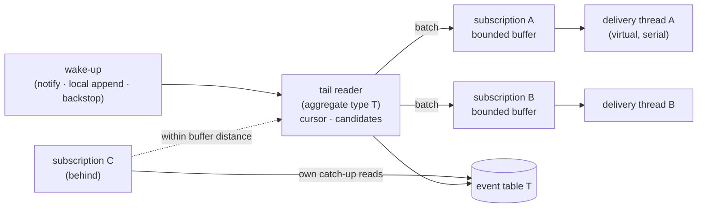

# Event Store Subscriptions — Redesign Proposal

**Status:** Proposal. Nothing here is built or measured. Written 2026-10-23.
**Scope:** how events get from the event-stream tables to subscribers — polling, gap handling, wake-up,
resume points and exclusive ownership. It also covers the question of building a new event store engine
beside `PostgresqlEventStore`, the way the shard-owned queue was built beside `PostgresqlDurableQueues`,
and what can be gained at the lower levels: statement shapes, raw JDBC and table design.

Related documents:

| Document | Relevance |
|---|---|
| [`subscription-improvements.md`](./subscription-improvements.md) | S1 (NOTIFY-reset backoff, shipped), S2 (interruptible wake-up, never built), S5/S6 (resume-point saves and the reposition epoch) |
| [`durable-queue-shard-owned.md`](../design/durable-queue-shard-owned.md) | The engine whose lessons this borrows: cursor, holes, wake-up tiers, leases, fencing |
| [`durable-queue-ordered-routing-design.md`](../design/durable-queue-ordered-routing-design.md) §3 | The safe watermark, which is the core mechanism proposed here |
| [`archive/durable-queue-design-history.md`](../archive/durable-queue-design-history.md) §9 | The defect log. Most of its entries have an equivalent hazard in this design |
| [`key-partitioned-event-processing.md`](../design/key-partitioned-event-processing.md) | EF-2. A shared reader with owned units is option (b) of that document, made cheaper |
| [`cdc.md`](../design/cdc.md) | The alternative live path, and what this proposal would make optional |
| `components/postgresql-event-store/CLAUDE.md` | The gotcha list, most of which is about the mechanism this proposal replaces |

---

## 0. Summary

1. **Replace time-based gap handling with a safe watermark.** Today a hole in `global_order` is a
   database row per subscriber, re-queried on every poll and promoted to permanent after 120 seconds.
   The ordered lane of the shard-owned queue instead asks PostgreSQL which write transactions are still
   running. A hole closes when the transactions that could fill it have finished — exactly, with no
   timer and no writes. The watermark needs **no schema change** to the event-stream tables.
2. **Read each aggregate type's tail once per JVM, not once per subscription.** Per-subscriber gap state
   is what forces every subscription to poll on its own. Without it, subscriptions that have caught up can
   share one reader. Statement count then grows with the number of aggregate types, not subscriptions × JVMs.
3. **Wake the reader with signals the way the queue does**: an application-issued, coalesced `NOTIFY`
   instead of a per-row trigger, a listener that blocks rather than polls, and a local wake-up when the
   append happened in the same JVM. Correctness never depends on any of them.
4. **Fence every resume-point write** with the exclusive owner's fence token in the same statement.
5. **Build it as a new engine beside the old one**, with an adapter that implements `EventStore` and
   `EventStoreSubscriptionManager`, the same three-module shape as the shard-owned queue. Because the
   watermark needs no schema change, the new engine can run on the **existing tables and existing resume
   points**. Switching between the engines then works in both directions, which is the cheapest
   migration this project has ever been able to offer.
6. **Treat lower-level optimisation (raw JDBC, table layout) as a separate, measured step.** The engine
   should use raw pgjdbc for the specific capabilities it needs (array binding, blocking notifications,
   multi-statement round trips, streaming), not on the assumption that JDBI is slow. Nothing in this
   repository has measured JDBI's overhead. Table-layout changes are opt-in for new tables only, and each
   one needs its own measurement.

Two corrections to ideas that came up while discussing this, each explained below:
- `pg_current_snapshot()` does **not** list every running writer (§4.4). The watermark has to read
  `pg_stat_activity.backend_xid`, as the queue does.
- Ordering the cursor by a per-row transaction id **breaks per-aggregate ordering** (§4.5). The cursor
  has to stay on `global_order`.

---

## 1. Goals, must-keep semantics and non-goals

### Goals

| Goal | Concretely |
|---|---|
| Correctness | No event lost to a long transaction, a sequence jump, a lost notification, a lost connection, a crash or a lock takeover. No correctness property depends on a timeout |
| Resources | Idle cost independent of the number of subscriptions. Statements per delivered event fall as load rises. No writes on the read path |
| Performance | Cross-JVM wake-up in the low milliseconds instead of S1's backoff interval. Throughput of a caught-up subscription limited by its handler, not by polling |
| Simplicity | Remove the gap machinery: transient and permanent gap tables, promotion, gap-middle tracking and the gap-fill acknowledgement protocol |

### Must keep

- At-least-once delivery. Handlers are idempotent, and a crash may redeliver.
- Per-aggregate order: an aggregate's events reach a subscriber in `EventOrder` order.
- `GlobalEventOrder` per aggregate type, as an independent space per table.
- Durable resume points in `durable_subscriptions`, and `resetFrom` together with the S6 reposition epoch.
- Exclusive subscriptions: one consumer per subscriber id across the cluster.
- In-transaction subscribers (`InTransactionEventProcessor`, `EventStoreEventBus`) that run inside the
  appender's commit. They are outside this proposal and must keep working unchanged.
- The persisted JSON wire format, which is frozen (root `CLAUDE.md`).
- The error-policy contract: retries run synchronously on a per-subscription delivery thread.
- Multi-tenancy, filtered in memory after reading (never by SQL, which creates fake gaps).

### Non-goals

- Exactly-once delivery.
- Ordering across aggregate types.
- Replacing in-transaction delivery.
- Changing the delivery order of a late commit. Today a late commit can arrive after higher global
  orders as a gap fill. It still will, and that is within the contract.

---

## 2. How it works today, and where the cost comes from

Each subscription has its own poll loop (`PostgresqlEventStore.pollEvents`). On every poll it:

1. opens a `UnitOfWork`, which means a transaction on a pooled connection;
2. resolves a batch size, which after empty polls can mean an extra probe
   (`findLowestGlobalEventOrderPersisted`);
3. asks the gap handler for transient gaps to include, using the rotating selection;
4. loads the range, together with any gap-middle fills;
5. reconciles gaps, which writes rows to `transient_subscriber_gaps` and promotes rows to `permanent_gaps`;
6. commits;
7. sleeps `EventStorePollingOptimizer.currentDelayMs()`, which nothing can interrupt.

The gaps exist because `global_order` comes from an identity sequence. A transaction that takes value
100 can commit after another one commits 101. A cursor reading `> 99` sees 101, and 100 then appears
behind it. The current design records every hole it steps over, per subscriber, and gives up on a hole
after a timeout (`transientGapGiveUpThreshold`, 120 s by default). Three properties follow, and they
are the costs this proposal targets:

- **Correctness depends on time.** A transaction that commits after the hole was promoted is skipped by
  every subscriber. The module `CLAUDE.md` records the coupling to `statement_timeout`.
- **The read path writes.** Gap reconciliation inserts, deletes and promotes rows. A poll is never
  read-only, so it can never move to a replica or skip its transaction.
- **Subscriptions cannot share work.** Gap state is per subscriber, so two subscriptions at the same
  position still issue their own statements. Load is subscriptions × JVMs × poll rate.

Most of the module's gotchas exist to keep this mechanism correct: `GapFillsAwaitingAcknowledgement`,
`GapMiddlesAwaitedInMemory`, `GapMiddlesAwaitedAcrossSubscribes`, `TransientGapsQuerySelection`, the
bind-parameter cap on give-ups, `CdcDeliveryTracker`'s give-up timer, and resolving a gap only once the
subscriber has acknowledged its fill. Each was a real bug. Their number is the strongest argument that
the mechanism itself, not its implementation, is the problem.

---

## 3. What the shard-owned queue taught

Each lesson below has a section in this proposal that applies it.

| Lesson | Source | Applied in |
|---|---|---|
| A hole can be closed exactly by asking which writers are still running, instead of waiting out a timer | ordered-routing §3 | §4 |
| Read `S` (highest seen) **before** `X` (running writers). Reversed, a writer slips between the two reads | ordered-routing §3 | §4.2 |
| Compare **sets** of `backend_xid`, never numbers: `xid` wraps at 32 bits, `xid8` does not, and there is no cast | ordered-routing §3, shard-owned §17.1 | §4.2 |
| `pg_snapshot_xmax` does not bound running writers. One running writer can read as an empty snapshot | ordered-routing §3 | §4.4 |
| A writer must hold its xid **before** it takes a sequence value, or it is invisible while holding one. Happened once in ~20 minutes in the trading demo | shard-owned §2.8 | §4.3 |
| `backend_xid` visibility is the one hard prerequisite. A partial answer silently loses data, so prove it at start-up by constructing the condition | shard-owned §17.2 | §4.3 |
| Coalesce `NOTIFY` per commit and issue it from the application, never from a per-row trigger. The notify queue is serialised cluster-wide | shard-owned §6 | §6 |
| The listener connection does no other work, and re-runs `LISTEN` after reconnecting. Its failure is silent by construction, so tests must assert notification counts | shard-owned §6, history §9.12 | §6 |
| Losing every notification may cost latency and nothing else | shard-owned §5.1 | §6 |
| Every durable write asserts its fence in the same statement. Zero rows updated is ambiguous: check ownership directly | shard-owned §5.4, §8.3 | §7 |
| All durable time is the database's | history §9.11 | §7 |
| An interrupted handler is not a success | shard-owned §5.5 | §5 |
| A lost connection must not stall a unit forever. Frozen-but-alive owners must stop themselves | history §9.8, §9.10 | §7 |
| Idle cost must be measured with a gate from the start, per queue, per unit and per instance | history §9.20 | §12 |
| An asynchronous delivery decision made the cursor, hole set, in-flight set and ack floor concurrent, and produced a duplicate | history §9.23 | §5 |

---

## 4. The core mechanism: a safe watermark over `global_order`

### 4.1 What it replaces

The reader keeps delivering everything it can see, as today. What changes is how it decides that a
hole below its cursor can no longer fill. It stops recording holes in the database, and stops promoting
them on a timer. It keeps an in-memory list of *candidates*, and each candidate retires at the moment
PostgreSQL proves that no writer can still commit below it.

### 4.2 The rule

This is taken unchanged from the ordered lane (ordered-routing §3). At the moment of a probe, let:

- **`S`** be the highest `global_order` this reader has actually read;
- **`X`** be the *set* of `backend_xid` values in `pg_stat_activity` that are not null, read **after** `S`.

Any transaction that could still commit a `global_order ≤ S` already had its xid when `S` was observed,
so it is in `X`, provided the prerequisite in §4.3 holds. Once no member of `X` is still running,
every `global_order ≤ S` is resolved: either committed and visible, or aborted and never coming.

When a candidate `(S, X)` retires, the reader issues **one** read of the holes it recorded at or below
`S`. Whatever that read returns is delivered as a late commit. Every remaining hole at or below `S` is
then permanent, for this reader and for good. Until the candidate retires, nothing is skipped; at worst
something is delayed.

Retirement is tested by **set disjointness**, not numerically, because `backend_xid` is a wrapping
32-bit `xid` while the snapshot functions return a non-wrapping `xid8`.

### 4.3 Prerequisites

Each of these is load-bearing. Each was learned on the queue and must carry over.

1. **The xid before the sequence value.** An identity default runs `nextval` when the `INSERT` evaluates
   its row, before the heap write that assigns the xid. Most `nextval` calls do not assign an xid
   themselves: only one in 32 is WAL-logged. In between, the writer holds a `global_order` and is
   invisible to `X`. The append path therefore runs `SELECT pg_current_xact_id()` before its first
   insert in each unit of work. A unit of work that already holds an xid can skip it. The cost is one
   statement per unit of work, and the round trip can be avoided (§9.2).
   The test is the queue's `ShardOwnedWatermarkXidWindowIT` pattern: a `BEFORE INSERT` trigger holds the
   window open, and the test must fail without the fix.
2. **`backend_xid` must be fully visible.** The queue's start-up probe forces a real xid on a second
   connection and requires the first to see it (`ShardOwnedSchema.verifyWatermarkPrerequisites`).
   Reuse the same probe. Stock PostgreSQL passes it for an ordinary role. A managed service may not, and
   then the engine must refuse to start rather than lose events.
3. **Identity sequences with `CACHE 1`.** Values must be handed out in wall-clock order. That is the
   identity default, but the engine must verify it at start-up, because an operator can change it.
4. **Appends from outside the engine.** A raw SQL `INSERT` into an event table that skips step 1 breaks
   the rule. This must be documented. A trigger cannot fix it, because the trigger runs after `nextval`.

### 4.4 Why not `pg_current_snapshot()`

Reading the snapshot looks like the cleaner way to find running writers, because it needs no
`pg_stat_activity`. It is unsafe. `pg_snapshot_xip` lists only in-progress xids below `xmax`, and
`xmax` is `latestCompletedXid + 1`. A writer whose xid was assigned after the last completion sits at or
above `xmax` and appears nowhere. The queue measured that under eight concurrent 50 ms transactions,
98% of samples look idle.

`pg_snapshot_xmin` is safe, since nothing below it is running, but it is cluster-wide. It cannot say
*which* writers to wait for, only that the oldest one finished, so it waits on every unrelated writer
for every candidate. The `backend_xid` set waits only on writers that were running when `S` was read.
It is still global in the sense that those may be unrelated writers, but a candidate retires as soon as
that particular set has finished.

A snapshot also cannot be taken on a standby and compared with the primary's `pg_stat_activity`, so
**the watermark ties the reader to the primary**. Moving reads to a replica, which an earlier draft of
this idea suggested, is not available with this rule.

### 4.5 Why not a cursor over a per-row transaction id

The alternative is to store `pg_current_xact_id()` in each row (`append_xid xid8`) and read
`WHERE append_xid < pg_snapshot_xmin(pg_current_snapshot()) ORDER BY append_xid, global_order`. It looks
attractive: holes vanish, because the cursor runs over values that are final by construction.

It **breaks per-aggregate order**, and the Essentials unit-of-work pattern makes the counterexample common:

1. T2 starts and writes a projection row. It is assigned xid 5.
2. T_long has xid 10. It appends A#5 and commits.
3. Some writer with xid 7 is still running, so `xmin` is 7.
4. T2 loads aggregate A, sees A#5, appends A#6 and commits.
5. A#6 (xid 5) is below `xmin` and therefore final. A#5 (xid 10) is not yet final.
6. The reader delivers A#6 before A#5.

The `global_order` cursor does not have this problem. The unique constraint on
`(aggregate_id, event_order)`, together with an `event_order` derived from committed state, forces A#5's
commit to happen before A#6's insert. A#5 therefore has the lower `global_order` and is visible no later
than A#6. The per-aggregate order guarantee of this proposal rests on exactly that argument, which is
also what today's design relies on. It must be written down as an invariant and tested (§11).

### 4.6 Long-running writers

The horizon is database-wide. A long **writing** transaction anywhere — a batch job, or a session idle
in a transaction that has written — keeps candidates from retiring. Read-only transactions do not,
because they have no xid.

The queue answers this with `watermarkCap`. After 60 seconds it advances anyway and counts
`watermarkCapped`; that path can skip messages. **The event store does not need a cap that skips.**
The queue had to bound the cap because rows are deleted on acknowledgement. Event rows are never
deleted, so a candidate that has not retired costs one list entry in memory and nothing else. Live
delivery continues above the hole. The only thing that grows is the replay window after a crash (§4.7).
What the engine needs instead is a metric: the age of the oldest unretired candidate, and the xid that
holds it back. A writer holding up subscriptions for minutes is something an operator should see.

### 4.7 What is persisted

The durable resume point must never pass an order that could still be delivered. Per subscriber it is:

```
resumeFrom = min( safeWatermark + 1 , lowest delivered-but-not-yet-handled order )
```

Here `safeWatermark` is the highest `S` of a retired candidate for which every event at or below it has
been handled. After a crash, the subscription replays from `resumeFrom`. That replays at most the events
committed since the oldest unretired candidate, which is within the at-least-once contract.

This is compatible with the existing `durable_subscriptions` table: the value is still a
`GlobalEventOrder`. The S6 reposition epoch is unchanged.

### 4.8 Sequence jumps

A `setval` or a restore that jumps the sequence by a million values is one hole range. It costs one
candidate and one ranged read when it retires, which is an indexed range scan returning only the rows
that exist. No rows are written. The present design needed `GapMiddlesAwaitedInMemory` to avoid writing
a million rows.

---

## 5. One shared reader per aggregate type per JVM

Without per-subscriber gap state, every subscription that is at the tail wants exactly the same rows.
Each JVM therefore runs one **tail reader** per aggregate type. It owns the cursor, the candidate list
and the read statement, and it publishes each batch to its *attached* subscriptions.



- **Catch-up.** A subscription that is far behind reads on its own, in bounded batches, until it is
  within its buffer's distance of the tail. It then attaches. This is the shape `BackfillThenLiveOrdered`
  already has, with the tail reader in place of the CDC bus, and the same rule applies: attach first,
  then read up to the head, then drain (module `CLAUDE.md`, "every move onto the CDC bus catches up first").
- **A slow subscription must never slow the reader.** When its buffer is full, it detaches and goes back
  to catch-up, instead of applying back-pressure to the reader. That is the CDC bus overflow lesson
  (F-871): a multicast paced by its slowest subscriber stalls everyone.
- **Delivery stays serial per subscription.** Each subscription has its own delivery thread. A virtual
  thread is fine, but it must not be shared. Error-policy retries stay synchronous on that thread.
- **The reader's dispatch decision is inline and single-threaded.** Cursor, candidate list and hole set
  are touched by one thread only. The queue's §9.23 is the cautionary tale: making that decision
  asynchronous produced a duplicate.
- **An interrupted handler is not handled**, so the resume point does not move past it.
- **Tenants** are filtered per subscription, after the shared read, as both paths do today.

**Expected effect.** For a caught-up system, read statements become *aggregate types × JVMs × wake-ups*,
independent of the number of subscriptions. This is the largest resource gain in the proposal, and it is
the one that §12 must measure first.

**Key-partitioned processing (EF-2).** The shared reader makes EF-2's option (b) cheaper. One JVM reads
the tail once and dispatches only the units it owns, each with its own resume point. That is a later
step, not part of the first version.

---

## 6. Wake-up

Three tiers, applying the queue's design (shard-owned §6). As there, correctness never depends on any tier.

| Tier | Mechanism | Replaces |
|---|---|---|
| 0 — backstop | The reader parks until a backstop interval elapses, then reads | the polling optimizers' sleep |
| 1 — cross-JVM | The appending unit of work issues one `pg_notify('essentials_eventstore', '<table>')` per table per commit, inside the transaction. One listener connection per JVM blocks on `PGConnection.getNotifications(timeoutMs)` and wakes the matching readers | S1's per-row trigger and `MultiTableChangeListener`'s timed polling |
| 2 — same JVM | A commit callback (`PersistedEventsCommitLifecycleCallback` exists already) wakes the local reader directly, with no database involved | nothing |

Rules carried over:

- **No per-row trigger.** S1 installs one (`ListenNotify.addChangeNotificationTriggerToTable`), which
  turns every event into a notification. The application-issued notify is coalesced and payload-light.
- **The listener does no work.** It only signals. It reconnects *and* re-runs `LISTEN`, and that path is
  tested by counting notifications, since delivery-based tests cannot see it fail.
- **Tier 2 wakes; it does not hand events over**, at least in the first version. The queue's local
  hand-off was measured to work only half the time (history §9.4). Waking a reader that then reads costs
  one statement and keeps a single delivery path. A direct hand-off is a later, measured optimisation.

This delivers S2's goal — interruptible wake-up, with backstop and latency decoupled — without changing
the `EventStorePollingOptimizer` SPI.

---

## 7. Exclusive subscriptions: ownership and fencing

Today an exclusive subscription holds a `FencedLock`. Its resume-point save
(`PostgresqlDurableSubscriptionRepository`, the batched `UPDATE`) is guarded by `reposition_epoch`, but
**not** by the lock's fence token. A former owner that has lost the lock without noticing — a GC pause,
or a partition — can still write the resume point after the new owner has taken over. The row then flaps
between two values until one of them stops.

Proposal:

- The resume-point `UPDATE` asserts the owner's fence in the same statement (`AND EXISTS (… lock row with
  this owner and this fence …)`), as the queue's acknowledgement delete does.
- Zero rows updated is ambiguous: it means either a stale fence or a superseding reset. Ask once, by
  primary key, which of the two it was. Lost ownership stops the subscription. A superseding reset is
  S6's case and is handled as now.
- An owner that cannot confirm it is alive — it cannot reach the database to renew — stops delivering
  (shard-owned §8.6).
- All lease time is server time (`now()`), never the JVM's clock.

Many exclusive subscriptions per JVM could later share lease rows, as the queue's units do instead of
one lock per subscriber. That belongs in a later phase; the fence on the write comes first, because it is
a correctness fix that also applies to the current engine.

---

## 8. A new engine beside the old one

### 8.1 Why a new engine rather than evolving `PostgresqlEventStore`

| | Evolve in place | New engine + adapter |
|---|---|---|
| Removing the gap machinery | Entangled. `GapFillsAwaitingAcknowledgement` and `AcknowledgementRegistrations` are shared with `CdcEventStore`, and `EventStreamGapHandler` is a public SPI | Free. The new engine never had it |
| Shared reader | Fights the per-subscription `pollEvents` Flux contract | Native |
| Side-by-side measurement | Feature flags inside one class | Two implementations of one interface, run against the same tables |
| Risk to existing users | Every change ships to everyone | Opt-in, and reversible (§8.4) |
| Precedent | — | The shard-owned queue: engine, adapter, starter |
| Cost | Lower up front | Higher. The adapter surface is large (§8.3) |

Recommendation: **a new engine**, built the way the queue was.

### 8.2 Module shape

| Module | Depends on | Contents |
|---|---|---|
| engine (working name `postgresql-event-log`) | `shared`, pgjdbc, slf4j, micrometer (optional) | Append, stream load, tail reader, watermark, wake-up, leases, resume points. Raw JDBC, no JDBI, no Reactor, no Jackson. Payloads are opaque to it, as in the queue |
| adapter | engine, `postgresql-event-store`, foundation | Implements `EventStore`/`ConfigurableEventStore` and `EventStoreSubscriptionManager` on top of the engine. Serialisation, interceptors, in-memory projectors, the event bus, causation, the unit-of-work integration |
| starter | adapter | Spring wiring, properties, health, admin API mapping |

The engine's write API takes a caller's `java.sql.Connection`, as `ShardOwnedQueue.enqueue(Connection, …)`
does, and commits nothing. The adapter takes the connection from the current `EventStoreUnitOfWork`
(its JDBI handle exposes it), so appends join the caller's transaction exactly as now. In-transaction
subscribers keep running inside that commit, through the adapter, unchanged.

### 8.3 What the adapter must implement

`EventStore` has around 50 abstract and default methods: `appendToStream` overloads, `fetchStream`,
`loadEvent(s)`, `loadEventsByGlobalOrder`, `pollEvents`/`unboundedPollForEvents` (Flux),
`findHighest/LowestGlobalEventOrderPersisted`, causation lookup, interceptors, projectors and the local
event bus. Everything above it — `EventProcessor`, `ViewEventProcessor`, `InTransactionEventProcessor`,
the aggregate repositories, the Kotlin decider support, the admin API — goes through these interfaces.
Without a complete adapter, nobody can adopt the engine. **Expect the adapter to be the larger half of
the work**, as it was for the queue.

Some methods have no natural meaning in the new engine:

- `pollEvents(…)` for a single caller. It can be served by attaching to the tail reader, or by a private
  reader for callers outside the manager. Both must honour `SubscriberAcknowledgement`, which becomes
  trivial: there are no gap fills to hold back.
- `forgetGapMiddlesAwaitedInMemory`, and the `EventStreamGapHandler` wiring, become no-ops.
- CDC. The new engine does not implement it. If §12 shows the shared reader and Tier 1 wake-up meet
  CDC's latency and load numbers, CDC remains with the old engine for users who need it for audit trails
  or replica offload. Otherwise CDC support is a later phase.

### 8.4 Coexistence and migration on the same tables

The watermark needs no new column, and resume points remain `GlobalEventOrder` values. The new engine
can therefore run on **the existing event-stream tables and the existing `durable_subscriptions` rows**:

- Switching to the new engine is a configuration change. Switching back is another one.
- **The one-time hand-over of open gaps.** When the new engine first takes over a subscriber, the old
  engine may have open transient gaps below that subscriber's resume point: fills it was still waiting
  for. The new engine reads that subscriber's `transient_subscriber_gaps` once at start, treats them as
  holes under a candidate taken at start-up, and deletes them only after that candidate retires. Without
  this, a late commit that was already outstanding at the switch would be lost.
- **Mixed versions during a rolling deploy.** Exclusive subscriptions are safe if both engines use the
  same lock names and fence semantics: one owner at a time, whichever engine it runs on. Non-exclusive
  subscriptions are per instance and unaffected.
- **Switching back.** The old engine resumes from the resume point. That is safe, because the new engine
  never persists past an unretired candidate (§4.7).

Table-layout changes (§9.3) are deliberately left out of this path. They would require a data migration
and would make the switch one-way.

---

## 9. Lower levels: statements, JDBC and tables

### 9.1 What is and is not known

- **Not measured:** JDBI's per-statement overhead compared with raw pgjdbc, in this codebase or the
  queue's. The queue's engine uses raw JDBC, but its documents attribute its gains to removing statements
  and writes (the claim write, the anti-join, the lock contention), not to the library.
- **Measured on the queue:** `bytea` instead of `jsonb` saved about 3% WAL for 200-byte payloads, and
  the saving is a fixed ~1.2–1.35 KB per message, so its share falls as payloads grow (history §9.1,
  measurements §3.4.3). "Real but small; it is not where the win lives."

So the expected order of gains is: fewer statements and no writes on the read path (§4–§5) ≫ fewer round
trips per statement (§9.2) > table layout (§9.3) > library overhead. Phase 0 must confirm this before
any layout change is chosen.

### 9.2 Why the engine should use raw pgjdbc anyway

Not for speed, until that is measured, but for capabilities JDBI hides or makes awkward, and for a
dependency footprint matching the queue's (`shared` plus pgjdbc):

| Capability | Use |
|---|---|
| `PGConnection.getNotifications(int timeoutMillis)` | A blocking listener (§6). `MultiTableChangeListener` calls `getNotifications()` on a timer today |
| Arrays bound as one parameter (`= ANY(?)`, `unnest(?::bigint[], …)`) | Hole reads and multi-event appends as a single statement with a single plan, whatever the count. Also avoids the 65 535 bind-parameter cap the gap handler hit |
| Several statements in one round trip | pgjdbc sends `SELECT pg_current_xact_id(); INSERT …` as one batch of protocol messages with a single sync. That could make the xid prerequisite (§4.3) cost no extra round trip. **Verify this with a test**, including that the two statements execute in order |
| `setFetchSize` with autocommit off | Streaming catch-up reads for subscriptions that are far behind, without materialising the batch |
| Control of `prepareThreshold` and statement reuse | One stable SQL text per statement shape, so server-side prepared plans are reused |
| `CopyManager` | Bulk import and any future table migration |

Statement shapes for the engine:

- **Tail read:** a single autocommit statement — `SELECT … WHERE global_order > ? ORDER BY global_order
  LIMIT ?` — with no `BEGIN`/`COMMIT` around it and no gap reconciliation after it.
- **Running writers:** `SELECT backend_xid FROM pg_stat_activity WHERE backend_xid IS NOT NULL`, issued
  only while a candidate is outstanding (the queue measured 0.086 ms, and skips it entirely when caught up).
- **Hole read on retirement:** `WHERE global_order = ANY(?)` for few holes, or a range read for wide ones.
- **Append:** `INSERT … SELECT * FROM unnest(?, ?, …) RETURNING global_order`, one statement per call,
  compared in phase 0 with the current JDBC batch.
- **Resume points:** one batched, fenced `UPDATE` (§7).

Phase 0 counts the current engine's statements per poll and per delivered event with
`pg_stat_statements`, so these shapes are compared against real numbers rather than against a reading of
the code.

### 9.3 Table design options

All of these are opt-in, apply to **new tables only**, and are each justified by their own measurement.
None is needed for §4–§8.

| Option | Expected effect | Cost, risk |
|---|---|---|
| **UUIDv7 event ids** (time-ordered) instead of random UUIDs | The `UNIQUE(event_id)` index becomes append-mostly instead of random inserts: fewer page splits, smaller index, less WAL. Probably the largest per-insert saving among these | Event ids become roughly time-ordered, which leaks timing. Existing tables keep random ids. `EventId` generation must stay a framework detail |
| **Make `UNIQUE(event_id)` optional** | One btree less per insert | `findEvent(EventId)` needs it. Opt-out only for users who never look up by id |
| **Payload as `json` or `bytea` instead of `jsonb`** | No binary conversion on write or read. `bytea`/`json` keep bytes exactly, whereas `jsonb` normalises — the CDC parity gotcha exists because of that | Users query `jsonb` payloads in SQL, and the admin UI reads them. The queue measured only ~3% WAL. Keep `jsonb` as the default. The `eventJsonColumnType` setting already exists |
| **Intern `event_type`** into a small-int registry, as the queue interns queue names | Narrower rows and indexes | Rows stop being readable without a join. Low value unless type names are long and rows small |
| **Column order by alignment** (fixed-width first, variable-width last) | A few bytes per row of padding saved | Only for new tables. Trivial |
| **Insert-driven autovacuum tuning** (`autovacuum_vacuum_insert_scale_factor` per table) | Keeps the visibility map current on append-only tables, so the head probes (`max`/`min(global_order)`) stay index-only | A table-level setting. Document rather than force |
| **Range partitioning by `global_order`** | Archiving and detaching old events. Smaller hot indexes | `UNIQUE(aggregate_id, event_order)` and `UNIQUE(event_id)` cannot be enforced across partitions unless they include the partition key, which breaks their meaning. Only as a later archival feature, if at all |
| **Remove the gap tables** | Already follows from §4 | They stay until the old engine is retired |

---

## 10. PostgreSQL features, used and rejected

| Feature | Verdict | Why |
|---|---|---|
| `pg_stat_activity.backend_xid` (sets) | **Use** | The watermark's source of running writers. Probe it at start-up |
| `pg_current_xact_id()` | **Use** | Forces an xid before the identity value. Also the probe's tool |
| `pg_snapshot_xmin` | Use as a metric only | Safe, but cluster-wide and not specific to the candidate. Good for showing "oldest writer holding things up" |
| `pg_snapshot_xip` / `pg_snapshot_xmax` | **Reject** for deciding | Misses writers at or above `xmax` (§4.4) |
| Per-row `xid8` column as cursor | **Reject** | Breaks per-aggregate order (§4.5) |
| `pg_xact_status(xid8)` | Not needed | Disjointness of `backend_xid` sets answers the same question without a per-xid call |
| `LISTEN`/`NOTIFY`, coalesced and app-issued | **Use** | Tier 1 wake-up (§6) |
| Per-row `NOTIFY` trigger (S1) | **Retire** in the new engine | Serialises on the cluster-wide notify queue under load |
| Logical decoding / CDC | Keep in the old engine only | Its reason to exist — latency and load — should be met by §5–§6. Measure before deciding |
| Hot-standby reads | Not available | The watermark needs the primary's `pg_stat_activity` (§4.4) |
| `track_commit_timestamp` | **Reject** | Timestamps never order events (root `CLAUDE.md`) |
| A gapless counter row per aggregate type, locked until commit | **Reject** | Makes global order equal commit order, but serialises every writer of a type until its commit, including in-transaction handlers. The queue rejected the same idea on measurement: a producer waited 211 ms behind a 200 ms transaction |
| Advisory locks for exclusive ownership | Reject | A lease row with a fence makes every write assertable, which an advisory lock cannot (§7) |
| Array binding, `unnest`, multi-statement round trips | **Use** | §9.2 |

---

## 11. Invariants, and how they are verified

These must be written down before the code, and each must have a test that has been seen to fail
against a deliberately broken implementation. The queue's defect log shows that tests which inject
nothing pass on broken code (history §9.13).

| # | Invariant | Verification |
|---|---|---|
| I1 | No loss: every committed event reaches every active subscription at least once | Concurrent-writer ITs with random commit order and rollbacks. A long-transaction IT that commits after 5 minutes. A sequence-jump IT |
| I2 | Per-aggregate order: within one subscription incarnation, A#n is first delivered before A#n+1 | The §4.5 scenario as an IT against the engine (must pass) and against a per-row-xid cursor (must fail) |
| I3 | A resume point never passes an order that could still be delivered | Crash injected between delivery and handling, and between a candidate's retirement and its hole read |
| I4 | xid before value: no writer holds a `global_order` while its xid is null | `BEFORE INSERT` trigger holding the window open, after `ShardOwnedWatermarkXidWindowIT` |
| I5 | Fencing: a stale owner's resume-point write never lands after the new owner's | Pause the old owner (a debugger-style hook), take over, release, assert the row |
| I6 | Reset wins: a `resetFrom` survives a concurrent save | S6's existing ITs, run against the adapter |
| I7 | Progress: with no running writers, a committed event is delivered within the backstop interval with every notification lost | Listener killed, `NOTIFY` disabled |
| I8 | Hand-over: an open transient gap from the old engine is delivered after the switch | Old engine leaves a gap open, new engine takes over, the late transaction commits |
| I9 | A slow subscription never delays another | One handler blocked; the others' latency is unchanged |

The watermark and the shared reader together form a small state machine — reader, candidates, attached
and detached subscriptions, resume point — with writers committing in arbitrary order. It is worth
modelling (TLA+, or a deterministic simulation with property-based tests) before implementing it. The
queue's ordered lane needed three attempts to test ordering across a topology change honestly
(shard-owned §2.7). This design has the same kind of state.

---

## 12. Measurement plan

Rules from the queue work, which apply in full (the project's measurement discipline):

- A baseline of the current engine comes first, on the same machine, before any new code exists.
- Both trees are run from git worktrees outside `/workspace`, alternating rounds, with
  `-Dfailsafe.forkCount=1` and nothing else running.
- Benchmarks wire the engines the way the Spring starters do, since that is what users run.
- Each shape gets a fresh table.
- Every gate is decided before the run, and a result inside the noise counts as no gain.

| Shape | Metric | Why |
|---|---|---|
| Idle: 1, 10 and 50 subscriptions × 1, 2 and 4 JVMs, no writes | Statements/s (`pg_stat_statements`) | The resource goal. Expected: flat in subscriptions on the new engine, linear on the old |
| Steady: 1, 10 and 100 events/s, 10 subscriptions | p50/p99 end-to-end latency, statements per delivered event, WAL per event | The performance goal, against polling, S1 and CDC |
| Burst: 100 000 events, one subscription behind | Catch-up time, memory | Catch-up path and streaming reads |
| Concurrent writers: 8 writers, random rollbacks | I1, I2 hold; time from commit to delivery of late commits | Correctness under the case gaps exist for |
| Long writer: a 5-minute writing transaction elsewhere | Delivery latency of other events (expected unchanged), candidate age metric, replay window after a crash | §4.6 |
| Append: 1, 10 and 100 events per call | Latency, WAL; JDBC batch versus `unnest`; with and without the extra xid round trip | §9.2, and the cost of §4.3 |
| JDBI versus raw pgjdbc, same statement | CPU per statement, latency | Settles §9.1 instead of assuming it |
| Trading demo, phase 6 load driver | Orders/s, stage latencies | The realistic gate. The baseline is being recorded on this branch now |

---

## 13. Phases

Each phase ends with its gate met, or a recorded decision to stop.

| Phase | Content | Gate |
|---|---|---|
| 0 | Baseline of the current engine (§12). Statement counts per poll and per event. The model of §11 | Numbers recorded. Model checks I1–I3 |
| 1 | **Fenced resume-point writes in the current engine** (§7) | I5 fails before, passes after. Useful whatever happens next |
| 2 | Engine: append (xid first), stream load, tail reader with watermark, one subscription, backstop wake-up only | I1–I4 pass. Statements per event at or below baseline |
| 3 | Shared reader, attach/detach, catch-up | I9 passes. Idle statements flat in the number of subscriptions |
| 4 | Wake-up tiers 1 and 2 | I7 passes. Latency compared with S1 and CDC |
| 5 | Leases and exclusive subscriptions, fenced | I5 and I6 pass. Multi-JVM takeover ITs |
| 6 | Adapter: `EventStore`, subscription manager, processors, admin API | The existing processor and repository ITs pass against the adapter |
| 7 | Coexistence: open-gap hand-over, switching in both directions, mixed rolling deploy | I8 passes. A switch back and forth under load loses nothing |
| 8 | Starter, documentation, LLM docs, admin UI | Trading demo runs on the new engine at or above baseline |
| later | Table-layout options (§9.3), EF-2 units on the shared reader, direct local hand-off, CDC on the new engine | Each with its own measurement |

---

## 14. Risks and open questions

1. **`backend_xid` on managed PostgreSQL.** If a provider restricts `pg_stat_activity`, the engine
   cannot run there. The probe turns that into a start-up failure, but it is a real adoption limit.
   Check Azure Flexible Server, RDS/Aurora and Cloud SQL before committing to the design.
2. **Long writers in shared databases.** Latency is unaffected, but the replay window after a crash
   grows with the longest writer. That needs a metric and an operator-facing explanation, not a cap.
3. **The adapter surface.** About 50 methods, Reactor-based polling contracts and a Spring
   unit-of-work integration. This is most of the work, and most of the risk of subtle behaviour
   differences. The existing ITs, run against the adapter, are the only realistic parity check.
4. **External writers.** Any process that inserts into an event table without the xid-first rule breaks
   I4 silently. That needs documentation, and possibly a start-up warning if rows appear that the engine
   did not write. Detecting that reliably is an open question.
5. **CDC's future.** If the new engine meets CDC's numbers, CDC becomes a niche feature with a heavy
   operational cost. Whether to keep developing it is a product decision for after phase 4.
6. **Naming.** `postgresql-event-log` is a working name only.
7. **Release line.** The adapter must implement the current `EventStore` interface without changing it,
   so the engine can ship in a minor as an opt-in, as the queue did. Removing the gap SPI from the old
   engine is a separate decision for the next major.
8. **Interaction with the shard-owned queue's own pending fixes.** The watermark code should be shared
   rather than copied, if the queue's version is stable by then. Its defects so far have been in exactly
   this kind of code, and more fixes are coming in the next release.
