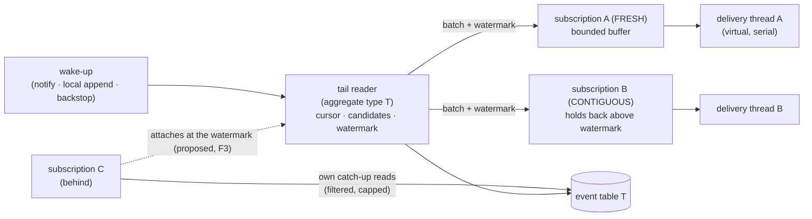

# Event Store Subscriptions — Redesign Proposal

**Status:** Proposal. Nothing here is built or measured. Written 2026-10-23; revised 2026-11-10 to fold in
what we learned from Marten's event store ([`marten-event-store-design.md`](./marten-event-store-design.md)).
**Scope:** how events get from the event-stream tables to subscribers — polling, gap handling, wake-up,
resume points and exclusive ownership — and the append path, because how events are written decides how
many holes the reader has to deal with. It also covers building a new event store engine beside
`PostgresqlEventStore`, the way the shard-owned queue was built beside `PostgresqlDurableQueues`, and
what can be gained at the lower levels: statement shapes, raw JDBC and table design.

**Focus of the revision:** performance, resource use and freshness, without weakening any ordering or
delivery guarantee. Every idea taken from Marten is listed in §3.2 with where it is applied, and every idea
deliberately *not* taken is listed in §3.3 with the reason.

Related documents:

| Document | Relevance |
|---|---|
| [`marten-event-store-design.md`](./marten-event-store-design.md) | Marten's append path, high-water mark, daemon, progress-in-transaction and fetch plans. The source of §5, §7, §8, §10 and §14 |
| [`subscription-improvements.md`](./subscription-improvements.md) | S1 (NOTIFY-reset backoff, shipped), S2 (interruptible wake-up, never built), S5/S6 (resume-point saves and the reposition epoch) |
| [`durable-queue-shard-owned.md`](../design/durable-queue-shard-owned.md) | The engine whose lessons this borrows: cursor, holes, wake-up tiers, leases, fencing |
| [`durable-queue-ordered-routing-design.md`](../design/durable-queue-ordered-routing-design.md) §3 | The safe watermark, which is the core mechanism proposed here |
| [`archive/durable-queue-design-history.md`](../archive/durable-queue-design-history.md) §9 | The defect log. Most of its entries have an equivalent hazard in this design |
| [`key-partitioned-event-processing.md`](../design/key-partitioned-event-processing.md) | EF-2. A shared reader with owned units is option (b) of that document, made cheaper |
| [`cdc.md`](../design/cdc.md) | The alternative live path, and what this proposal would make optional |
| `components/postgresql-event-store/CLAUDE.md` | The gotcha list, most of which is about the mechanism this proposal replaces |

---

## 0. Summary

1. **Replace time-based gap handling with a safe watermark.** Today a hole in `global_order` is a
   database row per subscriber, re-queried on every poll and promoted to permanent after 120 seconds.
   The ordered lane of the shard-owned queue instead asks PostgreSQL which write transactions are still
   running. A hole closes when the transactions that could fill it have finished — exactly, with no
   timer and no writes. The watermark needs **no schema change** to the event-stream tables (§4).
2. **Create fewer holes in the first place.** Append each aggregate's events with **one statement** that
   takes the transaction's xid, checks the expected event order and inserts set-based from column arrays
   — in that order, so a writer that loses an optimistic-concurrency check consumes **no** `global_order`
   value. This also removes today's extra round trip to look up the last event order (§5). The idea is
   Marten's; the set-based insert improves on Marten's row-by-row loop.
3. **Read each aggregate type's tail once per JVM, not once per subscription.** Per-subscriber gap state
   is what forces every subscription to poll on its own. Without it, subscriptions that have caught up can
   share one reader. Statement count then grows with the number of aggregate types, not subscriptions × JVMs
   (§6). While a hole is outstanding, the tail read and the running-writers probe become one statement (§4.10).
4. **Make the freshness/consistency trade-off a per-subscription choice.** `FRESH` delivers everything
   visible and lets a late commit arrive later (today's contract, best latency). `CONTIGUOUS` delivers only
   up to the watermark, as Marten does, which together with item 5 gives **exactly-once database state**.
   Both modes run on the same shared reader at no extra statement cost (§7). Default: `CONTIGUOUS` for view
   projections, `FRESH` for event processors (§20, D1).
5. **Commit progress with the output.** For handlers whose output lives in the same database, the resume
   point is written in the handler's own transaction, a page of events per transaction, with a
   compare-and-set on the reposition epoch and the owner's fence (§8). Marten's progress model, combined
   with this proposal's fencing.
6. **Fence every resume-point write** with the exclusive owner's fence token in the same statement (§9).
   This is a correctness fix that also applies to the current engine, so it ships first.
7. **Catch up cheaply.** Push event-type filters into SQL for subscriptions that are behind, advance
   progress to the watermark rather than to the last matching row, and cap concurrent catch-up reads per
   database (§10). Under the old gap handler, filtering in SQL created fake gaps; under the watermark it is safe.
8. **Wake the reader with signals the way the queue does**: an application-issued, coalesced `NOTIFY`
   instead of a per-row trigger, a listener that blocks rather than polls, and a local wake-up when the
   append happened in the same JVM. Correctness never depends on any of them (§11).
9. **Build it as a new engine beside the old one**, with an adapter that implements `EventStore` and
   `EventStoreSubscriptionManager`, the same three-module shape as the shard-owned queue. Because the
   watermark and the new append need no schema change, the new engine runs on the **existing tables and
   existing resume points**, and switching between the engines works in both directions (§12).
10. **Investigate before building.** Four claims carry the design and none is proven yet: that the
    single-statement append takes its xid before the identity value, that the combined probe reads
    running writers after its snapshot, that `backend_xid` is visible on the managed PostgreSQL services
    users run, and that the new append is actually faster. Phase 0 settles each with a spike that has a
    gate and a fallback (§18).
11. **Treat lower-level optimisation (raw JDBC, table layout) as a separate, measured step** (§13).
    The command side — loading aggregates for writing — is a separate track with its own phases (§14).

Two corrections to ideas that came up while discussing this, each explained below:
- `pg_current_snapshot()` does **not** list every running writer (§4.4). The watermark has to read
  `pg_stat_activity.backend_xid`, as the queue does. Marten's liveness probe uses the snapshot and needs a
  timer and tombstones to compensate; this design needs neither (§4.9).
- Ordering the cursor by a per-row transaction id **breaks per-aggregate ordering** (§4.5). The cursor
  has to stay on `global_order`.

---

## 1. Goals, must-keep semantics and non-goals

### Goals

| Goal | Concretely |
|---|---|
| Correctness | No event lost to a long transaction, a sequence jump, a lost notification, a lost connection, a crash or a lock takeover. No correctness property depends on a timeout |
| Freshness | Cross-JVM commit-to-handler latency in the low milliseconds instead of S1's backoff interval. In `FRESH` mode a slow writer delays only its own events |
| Resources | Idle cost independent of the number of subscriptions. Statements per delivered event fall as load rises. No writes on the read path. No sequence values burned by optimistic-concurrency losers |
| Performance | One round trip per appended aggregate. Throughput of a caught-up subscription limited by its handler, not by polling. Fewer transactions per delivered event for in-database projections |
| Simplicity | Remove the gap machinery: transient and permanent gap tables, promotion, gap-middle tracking and the gap-fill acknowledgement protocol |

### Must keep

- At-least-once delivery. Handlers are idempotent, and a crash may redeliver.
- Per-aggregate order: an aggregate's events reach a subscriber in `EventOrder` order.
- `GlobalEventOrder` per aggregate type, as an independent space per table.
- Durable resume points in `durable_subscriptions`, and `resetFrom` together with the S6 reposition epoch.
- Exclusive subscriptions: one consumer per subscriber id across the cluster.
- In-transaction subscribers (`InTransactionEventProcessor`, `EventStoreEventBus`) that run inside the
  appender's commit. They are outside this proposal and must keep working unchanged.
- The persisted JSON wire format, which is frozen (root `CLAUDE.md`).
- The optimistic-concurrency contract: `OptimisticAppendToStreamException` on a conflicting append, with
  the same message content and the same `UNIQUE(aggregate_id, event_order)` backstop.
- The error-policy contract: retries run synchronously on a per-subscription delivery thread.
- Multi-tenancy, filtered in memory after the shared read. Catch-up reads may filter by tenant or event
  type in SQL (§10), because the watermark no longer depends on seeing every row.

### Non-goals

- Exactly-once *delivery* (side effects outside the database stay at-least-once in every mode).
- Ordering across aggregate types.
- Replacing in-transaction delivery.
- Changing the delivery order of a late commit in `FRESH` mode. Today a late commit can arrive after
  higher global orders as a gap fill. In `FRESH` it still will, and that is within the contract.

---

## 2. How it works today, and where the cost comes from

### 2.1 The read path

Each subscription has its own poll loop (`PostgresqlEventStore.pollEvents`). On every poll it:

1. opens a `UnitOfWork`, which means a transaction on a pooled connection;
2. resolves a batch size, which after empty polls can mean an extra probe
   (`findLowestGlobalEventOrderPersisted`);
3. asks the gap handler for transient gaps to include, using the rotating selection;
4. loads the range, together with any gap-middle fills;
5. reconciles gaps, which writes rows to `transient_subscriber_gaps` and promotes rows to `permanent_gaps`;
6. commits;
7. sleeps `EventStorePollingOptimizer.currentDelayMs()`, which nothing can interrupt.

The gaps exist because `global_order` comes from an identity sequence. A transaction that takes value
100 can commit after another one commits 101. A cursor reading `> 99` sees 101, and 100 then appears
behind it. The current design records every hole it steps over, per subscriber, and gives up on a hole
after a timeout (`transientGapGiveUpThreshold`, 120 s by default). Three properties follow, and they
are the costs this proposal targets:

- **Correctness depends on time.** A transaction that commits after the hole was promoted is skipped by
  every subscriber. The module `CLAUDE.md` records the coupling to `statement_timeout`.
- **The read path writes.** Gap reconciliation inserts, deletes and promotes rows. A poll is never
  read-only, so it can never skip its transaction.
- **Subscriptions cannot share work.** Gap state is per subscriber, so two subscriptions at the same
  position still issue their own statements. Load is subscriptions × JVMs × poll rate.

Most of the module's gotchas exist to keep this mechanism correct: `GapFillsAwaitingAcknowledgement`,
`GapMiddlesAwaitedInMemory`, `GapMiddlesAwaitedAcrossSubscribes`, `TransientGapsQuerySelection`, the
bind-parameter cap on give-ups, `CdcDeliveryTracker`'s give-up timer, and resolving a gap only once the
subscriber has acknowledged its fill. Each was a real bug. Their number is the strongest argument that
the mechanism itself, not its implementation, is the problem.

### 2.2 The write path

`SeparateTablePerAggregateTypePersistenceStrategy.persist`:

1. When the caller gives no expected event order, it first runs `loadLastPersistedEventRelatedTo` — a
   separate statement and round trip — to find the aggregate's last event order.
2. It computes each event's `event_order` on the client and sends a JDBI `PreparedBatch` of single-row
   `INSERT … RETURNING global_order` statements. Nothing in the repository sets pgjdbc's
   `reWriteBatchedInserts`, so this is N executions; how many network round trips that costs under pgjdbc's
   defaults has not been measured.
3. An optimistic-concurrency conflict is detected when `UNIQUE(aggregate_id, event_order)` rejects the
   insert. By then the identity default has already handed out a `global_order`, so **every lost race
   leaves a hole** that every subscriber then has to wait out.

### 2.3 Resume points

`PostgresqlDurableSubscriptionRepository` saves resume points in a separate, batched transaction:
`UPDATE … SET resume_from_and_including_global_eventorder = … WHERE … AND reposition_epoch <= :epoch`.
The save is guarded by the reposition epoch but not by the exclusive lock's fence (§9), and it is never
in the same transaction as the handler's output, so a projection's state and its resume point can always
disagree after a crash. That is within at-least-once, but it means every projection must be idempotent and
every replay redoes work.

---

## 3. What the shard-owned queue and Marten taught

### 3.1 The shard-owned queue

Each lesson below has a section in this proposal that applies it.

| Lesson | Source | Applied in |
|---|---|---|
| A hole can be closed exactly by asking which writers are still running, instead of waiting out a timer | ordered-routing §3 | §4 |
| Read `S` (highest seen) **before** `X` (running writers). Reversed, a writer slips between the two reads | ordered-routing §3 | §4.2, §4.10 |
| Compare **sets** of `backend_xid`, never numbers: `xid` wraps at 32 bits, `xid8` does not, and there is no cast | ordered-routing §3, shard-owned §17.1 | §4.2 |
| `pg_snapshot_xmax` does not bound running writers. One running writer can read as an empty snapshot | ordered-routing §3 | §4.4 |
| A writer must hold its xid **before** it takes a sequence value, or it is invisible while holding one. Happened once in ~20 minutes in the trading demo | shard-owned §2.8 | §4.3, §5 |
| `backend_xid` visibility is the one hard prerequisite. A partial answer silently loses data, so prove it at start-up by constructing the condition | shard-owned §17.2 | §4.3 |
| Coalesce `NOTIFY` per commit and issue it from the application, never from a per-row trigger. The notify queue is serialised cluster-wide | shard-owned §6 | §11 |
| The listener connection does no other work, and re-runs `LISTEN` after reconnecting. Its failure is silent by construction, so tests must assert notification counts | shard-owned §6, history §9.12 | §11 |
| Losing every notification may cost latency and nothing else | shard-owned §5.1 | §11 |
| Every durable write asserts its fence in the same statement. Zero rows updated is ambiguous: check ownership directly | shard-owned §5.4, §8.3 | §8, §9 |
| All durable time is the database's | history §9.11 | §9 |
| An interrupted handler is not a success | shard-owned §5.5 | §6 |
| A lost connection must not stall a unit forever. Frozen-but-alive owners must stop themselves | history §9.8, §9.10 | §9 |
| Idle cost must be measured with a gate from the start, per queue, per unit and per instance | history §9.20 | §17 |
| An asynchronous delivery decision made the cursor, hole set, in-flight set and ack floor concurrent, and produced a duplicate | history §9.23 | §6 |

### 3.2 Marten: what is taken

Section numbers on the left refer to [`marten-event-store-design.md`](./marten-event-store-design.md).

| Marten idea | Marten § | Applied in | Change from Marten |
|---|---|---|---|
| Check the expected version **before** `nextval`, so a writer that loses the race consumes no sequence value | 3.1, 4.1 | §5 | No streams table: the check reads `max(event_order)` from the existing unique index |
| One round trip per appended stream, column arrays as parameters | 3.1, 11.1 | §5 | A set-based `INSERT … SELECT FROM unnest(…)` instead of a PL/pgSQL loop, and a plain statement instead of a function |
| Map concurrency violations by constraint name, never by parsing the error detail | 3.4 | §5 | Already done today (`isOptimisticConcurrencyViolation`); kept |
| Every high-water reading is one SQL statement, so one snapshot | 4.3 | §4.10 | Applied to the tail read plus running-writers probe |
| Never read past a high-water mark | 4.3 | §7 (`CONTIGUOUS`) | Optional per subscription instead of the only behaviour |
| Progress committed as a compare-and-set in the same transaction as the output | 6.2 | §8 | The compare-and-set is on the reposition epoch and the owner's fence |
| A page of events per transaction | 6.2, 7 | §8 | Falls back to one event per transaction when a page fails, so the error policy still applies per event |
| Push the event-type filter into SQL; advance progress to the high-water mark on sparse pages | 6.1 | §10 | Only for catch-up reads; the shared tail read stays unfiltered |
| Skip-ahead and windowed fallback when a filtered read times out | 6.1 | §10 | — |
| Cap concurrent event loads per database, separately from the pool | 6.1 | §10 | — |
| A monitored lock: a node that may have lost ownership stops | 6.3 | §9 | Lease row with a fence instead of an advisory lock |
| Fetch version, snapshot and tail events in one batch; `REPEATABLE READ READ ONLY` when the snapshot is asynchronous | 5 | §14 | Separate track |
| A node-local aggregate cache, entries taken out atomically and written back on commit, version always checked | 5 | §14 | Separate track |
| Keep frequently updated rows unindexed on the updated column so updates stay HOT | 9, 11.21 | §8 | `durable_subscriptions.resume_from…` is not indexed today; keep it that way and document fillfactor |
| Statement timeouts and prepared-statement measurements before assuming | 10 | §13 | — |

### 3.3 Marten: what is deliberately not taken

| Marten idea | Why not |
|---|---|
| **Tombstones** written at the seq_ids of failed appends | They exist because Marten's liveness probe needs a stale threshold before it can skip. Under the `backend_xid` rule an aborted writer's xid leaves `pg_stat_activity` at once, so its hole retires on the next probe without any write (§4.9). Tombstones would add writes and a second stream to every table |
| **Snapshot-based (`xip`/`xmax`) liveness probe plus a 3-second threshold** | `xip` misses writers at or above `xmax` (§4.4); Marten compensates with `pg_locks`, transaction start times and a timer. The xid-set rule is exact and has none of those parts |
| **A persisted, shared high-water mark** maintained by one leader (`mt_event_progression` rows `HighWaterMark`, `HighWaterStuckGap`, `mt_high_water_skips`) | It puts writes on the read path and adds a leader. Each JVM's reader derives its own candidates for free from the reads it is doing anyway |
| **The optional cap that forces a skip** after a longer time | Event rows are never deleted, so an unretired candidate costs one list entry, not data (§4.6) |
| **Advisory-lock leadership per shard** | Balances poorly ("first node grabs everything"), and an advisory lock cannot be asserted inside a write. Lease rows with fences can (§9) |
| **Rich append: client-side `nextval` pre-fetch** | Doubles the round trips and burns sequence values on every failed save |
| **A `streams` table with a version row per stream** | Would add an update per append and a schema change that makes the switch between engines one-way. The `max(event_order)` read on the existing unique index gives the same pre-`nextval` check. An opt-in transaction-scoped advisory lock covers Marten's `FOR UPDATE` use case for hot streams (§5.3) |
| **Tenant partitioning with a sequence per tenant** | Loses global order within an aggregate type, which `GlobalEventOrder` promises |
| **Coarse tag-version rows for consistency across streams (DCB)** | Out of scope; a hot tag becomes a write hotspot |

---

## 4. The core mechanism: a safe watermark over `global_order`

### 4.1 What it replaces

The reader keeps delivering everything it can see, as today. What changes is how it decides that a
hole below its cursor can no longer fill. It stops recording holes in the database, and stops promoting
them on a timer. It keeps an in-memory list of *candidates*, and each candidate retires at the moment
PostgreSQL proves that no writer can still commit below it.

### 4.2 The rule

This is taken unchanged from the ordered lane (ordered-routing §3). At the moment of a probe, let:

- **`S`** be the highest `global_order` this reader has actually read;
- **`X`** be the *set* of `backend_xid` values in `pg_stat_activity` that are not null, read **after** `S`.

Any transaction that could still commit a `global_order ≤ S` already had its xid when `S` was observed,
so it is in `X`, provided the prerequisite in §4.3 holds. Once no member of `X` is still running,
every `global_order ≤ S` is resolved: either committed and visible, or aborted and never coming.

When a candidate `(S, X)` retires, the reader issues **one** read of the holes it recorded at or below
`S`. Whatever that read returns is delivered as a late commit. Every remaining hole at or below `S` is
then permanent, for this reader and for good. Until the candidate retires, nothing is skipped; at worst
something is delayed.

> **Proposed revision (P0.5 F1, 2026-11-11, not decided).** The hole read after retirement must not be the only
> way a late commit is delivered. As written it breaks per-aggregate order in `FRESH` (I2): A#n commits late into a
> hole, A#n+1 is appended after it and read by the next probe above the cursor, and A#n arrives only when its candidate
> retires, which a long writer elsewhere can postpone indefinitely. Proposed: the tail statement also re-reads the
> outstanding holes (`WHERE global_order > :cursor OR global_order = ANY(:holes)`, with ranges for a sequence jump) and
> publishes what it finds in `global_order` ahead of the new rows. A#n+1 can only exist once A#n has committed (§4.5), so
> any snapshot that sees A#n+1 also sees A#n. The hole read at retirement stays: a writer can commit between the
> statement's snapshot and its read of the running set, so the retiring probe itself may not have seen the row. With
> this change the model passes every invariant in every configuration, including several events per transaction.
> Cost: a larger tail statement while holes are outstanding, no extra statement (§19, risk 13).
> [`event-store-phase0-model.md`](event-store-phase0-model.md) F1.

Retirement is tested by **set disjointness**, not numerically, because `backend_xid` is a wrapping
32-bit `xid` while the snapshot functions return a non-wrapping `xid8`.

The **watermark** of a reader is (proposed revision F2 below) the cursor, lowered to just below the lowest hole
that is not yet resolved. Every `global_order` at or below it is final: either read, or proven never to exist.

> **Proposed revision (P0.5 F2, 2026-11-11, not decided).** The definition as first written, "the highest `S` of a
> retired candidate such that no older candidate is still outstanding", says nothing once the cursor has moved past the
> last candidate's `S` with no new hole, and read literally lets the watermark advance at retirement, before the hole
> read. The model's mutant of that loses events: a `CONTIGUOUS` page commits past the hole before the late commit is
> published (I12), and a crash between retirement and the hole read leaves resume points past an unhandled event (I3).
> Proposed: `watermark = min(cursor, lowest unresolved hole − 1)`, where a hole is unresolved until its candidate has
> retired **and** the hole read has returned and its rows have been published.
> [`event-store-phase0-model.md`](event-store-phase0-model.md) F2.

> **Proposed revision (P0.5 F4, 2026-11-11, not decided).** Where a restarted tail reader starts was not specified.
> Starting at the head with the watermark at the head loses events (I13): a writer still holding a value below the
> head is invisible to a catch-up that is let past it. Proposed: a restarted reader starts at the head with one
> *initial candidate* `(head, running set)`, and its watermark is unknown until that candidate retires; until then no
> subscription catches up past the last known watermark or attaches. With no writer running at the restart, the
> watermark is the head at once. The same rule applies where a catch-up read computes the watermark with its own
> candidate (§10.1). [`event-store-phase0-model.md`](event-store-phase0-model.md) F4.

### 4.3 Prerequisites

Each of these is load-bearing. Each was learned on the queue and must carry over.

1. **The xid before the sequence value.** An identity default runs `nextval` when the `INSERT` evaluates
   its row, before the heap write that assigns the xid. Most `nextval` calls do not assign an xid
   themselves: only one in 32 is WAL-logged. In between, the writer holds a `global_order` and is
   invisible to `X`. The new append statement takes `pg_current_xact_id()` before any row reaches the
   insert (§5.1), so the prerequisite costs no extra statement. Whether that ordering holds is spike
   P0.1 (§18); the fallback is a separate `SELECT pg_current_xact_id()` sent in the same round trip.
   The test is the queue's `ShardOwnedWatermarkXidWindowIT` pattern: a `BEFORE INSERT` trigger holds the
   window open, and the test must fail without the fix.
2. **`backend_xid` must be fully visible.** The queue's start-up probe forces a real xid on a second
   connection and requires the first to see it (`ShardOwnedSchema.verifyWatermarkPrerequisites`).
   Reuse the same probe. Stock PostgreSQL passes it for an ordinary role. A managed service may not, and
   then the engine must refuse to start rather than lose events. Spike P0.3 checks the services users run.
3. **Identity sequences with `CACHE 1`.** Values must be handed out in wall-clock order. That is the
   identity default, but the engine must verify it at start-up, because an operator can change it.
4. **Appends from outside the engine.** A raw SQL `INSERT` into an event table that skips step 1 breaks
   the rule. This must be documented. A trigger cannot fix it, because the trigger runs after `nextval`.

### 4.4 Why not `pg_current_snapshot()`

Reading the snapshot looks like the cleaner way to find running writers, because it needs no
`pg_stat_activity`. It is unsafe. `pg_snapshot_xip` lists only in-progress xids below `xmax`, and
`xmax` is `latestCompletedXid + 1`. A writer whose xid was assigned after the last completion sits at or
above `xmax` and appears nowhere. The queue measured that under eight concurrent 50 ms transactions,
98% of samples look idle.

`pg_snapshot_xmin` is safe, since nothing below it is running, but it is cluster-wide. It cannot say
*which* writers to wait for, only that the oldest one finished, so it waits on every unrelated writer
for every candidate. The `backend_xid` set waits only on writers that were running when `S` was read.
It is still global in the sense that those may be unrelated writers, but a candidate retires as soon as
that particular set has finished.

A snapshot also cannot be taken on a standby and compared with the primary's `pg_stat_activity`, so
**the watermark ties the reader to the primary**. Moving reads to a replica, which an earlier draft of
this idea suggested, is not available with this rule.

Marten reached the same conclusion from the other direction: its high-water detector started with
wall-clock skipping, then added a liveness probe over `pg_locks`, `pg_stat_activity` and
`pg_snapshot_xip` with an xmax captured at observation time, still guarded by a stale threshold. That is
evidence for asking PostgreSQL which writers are running, and the `backend_xid` set is the exact form of it.

### 4.5 Why not a cursor over a per-row transaction id

The alternative is to store `pg_current_xact_id()` in each row (`append_xid xid8`) and read
`WHERE append_xid < pg_snapshot_xmin(pg_current_snapshot()) ORDER BY append_xid, global_order`. It looks
attractive: holes vanish, because the cursor runs over values that are final by construction.

It **breaks per-aggregate order**, and the Essentials unit-of-work pattern makes the counterexample common:

1. T2 starts and writes a projection row. It is assigned xid 5.
2. T_long has xid 10. It appends A#5 and commits.
3. Some writer with xid 7 is still running, so `xmin` is 7.
4. T2 loads aggregate A, sees A#5, appends A#6 and commits.
5. A#6 (xid 5) is below `xmin` and therefore final. A#5 (xid 10) is not yet final.
6. The reader delivers A#6 before A#5.

The `global_order` cursor does not have this problem. The unique constraint on
`(aggregate_id, event_order)`, together with an `event_order` derived from committed state, forces A#5's
commit to happen before A#6's insert. A#5 therefore has the lower `global_order` and is visible no later
than A#6. The per-aggregate order guarantee of this proposal rests on exactly that argument, which is
also what today's design relies on. The new append derives `event_order` from committed state on the
server (§5.1), so the argument carries over. It must be written down as an invariant and tested (§16, I2).

> **Proposed revision (P0.5 F1, 2026-11-11, not decided).** "Visible no later than A#6" is necessary for I2 but not
> sufficient: the tail read never looks below its cursor, so A#5 committing late into a hole is visible but not
> delivered until its candidate retires, after A#6 (§4.2). The argument holds for delivery only if the tail statement
> also re-reads the outstanding holes, as proposed in §4.2. It holds unchanged for a transaction of several events,
> whose values may interleave with other writers': the model checked that too.
> [`event-store-phase0-model.md`](event-store-phase0-model.md) F1.

### 4.6 Long-running writers

The horizon is database-wide. A long **writing** transaction anywhere — a batch job, or a session idle
in a transaction that has written — keeps candidates from retiring. Read-only transactions do not,
because they have no xid.

The queue answers this with `watermarkCap`. After 60 seconds it advances anyway and counts
`watermarkCapped`; that path can skip messages. **The event store does not need a cap that skips.**
The queue had to bound the cap because rows are deleted on acknowledgement. Event rows are never
deleted, so a candidate that has not retired costs one list entry in memory and nothing else.

What a long writer costs depends on the subscription's mode (§7):

- `FRESH`: live delivery continues above the hole. The only thing that grows is the replay window after
  a crash (§4.7).
- `CONTIGUOUS`: delivery stops at the watermark until the writer finishes. This is the price of
  exactly-once database state, and it is why `CONTIGUOUS` is not the default for event processors.

Either way the engine needs a metric: the age of the oldest unretired candidate, and the xid (and, from
`pg_stat_activity`, the pid, application name and transaction start) that holds it back. A writer holding
up subscriptions for minutes is something an operator should see.

### 4.7 What is persisted

The durable resume point must never pass an order that could still be delivered. Per subscriber it is:

```
resumeFrom = min( watermark + 1 , lowest delivered-but-not-yet-handled order )
```

After a crash, the subscription replays from `resumeFrom`. In `FRESH` mode that replays at most the
events committed since the oldest unretired candidate, which is within the at-least-once contract. In
`CONTIGUOUS` mode nothing above the watermark was handled, so with progress in the handler's transaction
(§8) nothing is replayed at all.

This is compatible with the existing `durable_subscriptions` table: the value is still a
`GlobalEventOrder`. The S6 reposition epoch is unchanged.

> **Proposed revision (P0.5 F5, 2026-11-11, not decided).** The same formula also gives the catch-up position of a
> subscription that detaches after an overflow (§6), with the event that did not fit counted as delivered but not
> handled: `min(watermark + 1, lowest buffered order, the order that did not fit) − 1`. Resuming from the watermark
> instead loses buffered, unhandled events (I13). An open page of an in-transaction subscription (§8.3) is left out of
> that position; if the page then rolls back, its events go back into the subscription's buffer.
> [`event-store-phase0-model.md`](event-store-phase0-model.md) F5.

### 4.8 Sequence jumps

A `setval` or a restore that jumps the sequence by a million values is one hole range. It costs one
candidate and one ranged read when it retires, which is an indexed range scan returning only the rows
that exist. No rows are written. The present design needed `GapMiddlesAwaitedInMemory` to avoid writing
a million rows.

### 4.9 Why no tombstones

Marten writes a tombstone row at every seq_id a failed save consumed, so its high-water mark need not
wait for the stale threshold. Here a failed transaction resolves its own holes: the moment it rolls back,
its xid is gone from `pg_stat_activity`, and the next probe retires every candidate that was waiting only
on it. The cost of a failed append is therefore one probe, not a write and not a timer.

Two kinds of failure are still worth reducing, because each hole means at least one probe statement and,
in `CONTIGUOUS` mode, a short stop:

- **Lost optimistic-concurrency races.** Removed by checking before the identity value is taken (§5.1).
- **Rolled-back units of work** after the append succeeded. These cannot be prevented and need nothing
  beyond the rule.

### 4.10 One statement per probe

Marten's detector learned (#4953 there) that probes split across statements under READ COMMITTED see
different snapshots, and a commit landing in between advances the mark over an in-flight value. The rule
in §4.2 has the same shape: `S` must be read before `X`. The current plan issues them as two statements,
which is correct but costs a round trip whenever a hole is outstanding.

While at least one candidate is outstanding, or while the previous read revealed a new hole, the tail
reader instead uses one statement:

```sql
SELECT e.<columns>,
       (SELECT array_agg(backend_xid::text) FROM pg_stat_activity WHERE backend_xid IS NOT NULL) AS running
FROM <event table> e
WHERE e.global_order > ?
ORDER BY e.global_order
LIMIT ?
```

(The final shape may return `running` once rather than per row, for example as a `UNION ALL` row or a
second result set; the point is one statement. Whatever the shape, it must return the running set even when
the tail read returns no rows: as written above, an empty tail never evaluates the sub-select, and an empty
read would then reveal nothing about outstanding candidates.)

The probe must run in autocommit, as a statement in its own transaction, or immediately after
`pg_stat_clear_snapshot()` when it has to run inside a transaction. Spike P0.2 (§21) found that the backend
status behind `pg_stat_activity` is cached per transaction: inside an explicit transaction that had already
read `pg_stat_activity`, the probe took a fresh READ COMMITTED snapshot but reused the earlier running set, and
missed a writer.

Why this should satisfy the rule: the statement's MVCC snapshot is taken when it starts, before the
executor reads `pg_stat_activity`. A writer holding a `global_order ≤ S` that is invisible to the
snapshot was running when the snapshot was taken and, by §4.3, already had its xid. When the executor
then reads `pg_stat_activity` it either is still running (and is in `X`) or has finished (and its value
is resolved). `S` is effectively read before `X`.

What must be checked, in spike P0.2: that `pg_stat_activity`'s per-transaction backend-status snapshot is
first taken during the statement's execution and not earlier, also on the extended query protocol with
pgjdbc's server-side prepared statements, and that the planner cannot hoist the sub-select into an
earlier phase. The test is an xid-window IT that holds a writer between taking its value and committing.
If the check fails, the reader keeps the two-statement form; nothing else in the design changes.

When no candidate is outstanding and the last read was contiguous, the plain tail read without the
sub-select is used, so an idle or contiguous system pays nothing (the queue measured the probe at
0.086 ms and skips it when caught up).

---

## 5. The append path

### 5.1 One statement per aggregate per unit of work

```sql
WITH xid  AS MATERIALIZED (SELECT pg_current_xact_id() AS x),
     head AS MATERIALIZED (SELECT coalesce(max(event_order), -1) AS v
                             FROM <event table> WHERE aggregate_id = $1),
     ok   AS (SELECT head.v FROM head, xid
               WHERE $2::bigint IS NULL OR head.v = $2)
INSERT INTO <event table> (aggregate_id, event_order, event_id, caused_by_event_id, correlation_id,
                           event_type, event_revision, timestamp, event_payload, event_metadata, tenant)
SELECT $1, ok.v + e.n, e.id, e.caused_by, e.correlation, e.type, e.revision, e.ts,
       e.payload::<eventJsonColumnType>, e.metadata::<eventMetadataJsonColumnType>, $3
FROM ok
CROSS JOIN unnest($4::<eventIdColumnType>[], $5::<eventIdColumnType>[], $6::<correlationIdColumnType>[],
                  $7::text[], $8::text[], $9::timestamptz[], $10::text[], $11::text[])
           WITH ORDINALITY AS e(id, caused_by, correlation, type, revision, ts, payload, metadata, n)
RETURNING global_order, event_order;
```

- `$2` is the caller's expected last event order (`appendEventsAfterEventOrder`), or null when the caller
  gave none. Event orders start at 0 and `NO_EVENTS_PREVIOUSLY_PERSISTED` is −1, hence the `-1` in `head`
  (corrected after P0.4; the first draft had `0`, which would have started every stream at 1).
- **Zero rows returned means an optimistic-concurrency conflict**, reported as
  `OptimisticAppendToStreamException` with today's message. No `global_order` was consumed, so no hole. This
  covers a conflict with an append that committed before the statement started; one with an append still in
  flight is §5.3's race, and P0.4 measured that as about half of all conflicts under contention.
- **No round trip to find the last event order.** `head` is an index-only backward scan of the existing
  `UNIQUE(aggregate_id, event_order)` index, run on the server. `event_order` is still derived from
  committed state, so the ordering argument in §4.5 holds.
- **One statement, one plan, whatever the number of events.** Payloads are bound as text arrays and cast
  to the configured column type, so the persisted bytes are what the serializer produced, and the wire
  format is untouched. Column names come from the existing `EventStreamTableColumnNames`; the statement is
  generated once per table, as today's insert SQL is.
- **The xid is taken before the identity value.** Every output row of the join needs a row from `ok`,
  and `ok` scans the materialised `xid`, so `pg_current_xact_id()` has run before the first row reaches the
  insert, where the identity default calls `nextval`. That is the reasoning; spike P0.1 has to prove it,
  including under a plan that puts `unnest` on the outer side of the join.
- Interceptors, `PersistableEventEnricher`s, serialisation and the `PersistedEvent` result stay in the
  adapter, client-side, exactly as today. One difference (P0.4): without an expected order the event order is
  only known after the insert, so the `PersistableEventMapper` and enrichers get a provisional order and the
  `PersistedEvent` is built from `RETURNING event_order`.

### 5.2 Several aggregates in one unit of work

One statement per (table, aggregate), sent as one pgjdbc batch, so a unit of work that touches several
aggregates still costs one round trip. Each statement's zero-row result is checked individually, so the
right aggregate is named in the exception.

### 5.3 A race that both writers win the check

Under READ COMMITTED two writers can both read the same `head` and both pass the check: `head` reads the
statement's snapshot, so a competitor that has inserted but not yet committed is invisible. The loser then
fails on the unique index after `nextval`, exactly as today, and leaves one hole. P0.4 measured this as not
rare: with 8 writers on 10 aggregates about half of all conflicts were of this kind, and §5.1 burned 248-270
identity values per 1 000 successful appends against today's 463-465 — half, not none.

*Note 2026-11-11:* the "half" depends on the client, not only on the statement. With raw pgjdbc and a fast lookup
the same statement burned 289-299 per 1 000; adding only a longer gap between the writer's lookup and its append
brought it to 216-225 (~70 µs lookup phase) and 181-184 (~180 µs), by turning would-be unique violations into
zero-row conflicts. Encoding, the engine's exact row and the tenant index did not move it.
[`event-store-phase0-append.md`](event-store-phase0-append.md) §8.3.

For aggregates known to be hot, offer an opt-in `pg_advisory_xact_lock(<hash of table, aggregate id>)`, **sent as
its own statement before the append**. It serialises writers of that one aggregate until commit, which is what
Marten's `FOR UPDATE` on the stream row does, and the append that follows starts with a snapshot that includes the
previous holder's commit, so every conflict becomes a zero-row result: P0.4 measured zero holes. It costs one
statement and round trip per append and, on a hot aggregate, throughput (a third of today's in P0.4's shape), which
is why it is opt-in. The lock must **not** be a CTE of the append, as the first draft said: the statement's
snapshot is taken before it waits for the lock, so `head` is still stale when the lock is granted, and P0.4
measured no reduction in holes at all with that shape.

*Note 2026-11-11:* a stream head table (`aggregate_id` primary key, `version`), moved by a guarded
`UPDATE … WHERE version = $expected` inside the append statement, gave zero holes in one statement and the same round
trips as §5.1, at 8-18% below §5.1's contended throughput in that spike's set-up, against a third of today's
for the advisory lock; a `SELECT … FOR UPDATE` first also gave zero holes, at about 30% below. This needs a new
table, so it is outside "the same rows" of §5.4 and §12.4. Findings, not a decision:
[`event-store-phase0-append.md`](event-store-phase0-append.md) §7.3. No cheaper parameter encoding brought §5.1's
contended throughput up to today's engine; the extra server CPU is not Bind-time array parsing (same doc, §6).

### 5.4 Relationship to the current engine

The single-statement append has no dependency on the new engine: it is a better way to write the same
rows. It could also replace the current engine's `PreparedBatch`. P0.4 measured what that would buy: about half
the lost-race holes the current gap handler has to wait 120 s for (not all of them, see §5.3), about a third less
latency for appends of 100 events, half the latency and 2 instead of 6 or 11 round trips for five aggregates in one
unit of work, and one round trip fewer whenever no expected order is given; nothing for appends of 1-10 events with
an expected order, where it ties. That remains a separate decision.

---

## 6. One shared reader per aggregate type per JVM

Without per-subscriber gap state, every subscription that is at the tail wants exactly the same rows.
Each JVM therefore runs one **tail reader** per aggregate type. It owns the cursor, the candidate list,
the watermark and the read statement, and it publishes each batch, together with the current watermark,
to its *attached* subscriptions.



- **Catch-up.** A subscription that is far behind reads on its own, in bounded batches (§10), until its
  catch-up position has reached the reader's watermark (proposed revision F3 below; first written as "within its
  buffer's distance of the tail"). It then attaches. This is the shape `BackfillThenLiveOrdered`
  already has, with the tail reader in place of the CDC bus, and the same rule applies: attach first,
  then read up to the head, then drain (module `CLAUDE.md`, "every move onto the CDC bus catches up first").
  The read after attaching (the bridge) covers `(catch-up position, reader cursor at attach]`.
- **A slow subscription must never slow the reader.** When its buffer is full, it detaches and goes back
  to catch-up, instead of applying back-pressure to the reader. That is the CDC bus overflow lesson
  (F-871): a multicast paced by its slowest subscriber stalls everyone. For `CONTIGUOUS` it is also a
  correctness rule (proposed revision F6 below). The catch-up resumes from §4.7's formula (proposed revision
  F5 below).
- **Delivery stays serial per subscription.** Each subscription has its own delivery thread. A virtual
  thread is fine, but it must not be shared. Error-policy retries stay synchronous on that thread.
- **The reader's dispatch decision is inline and single-threaded.** Cursor, candidate list, hole set and
  watermark are touched by one thread only. The queue's §9.23 is the cautionary tale: making that
  decision asynchronous produced a duplicate.
- **An interrupted handler is not handled**, so the resume point does not move past it.
- **Tenants** are filtered per subscription, after the shared read, as both paths do today.

> **Proposed revision (P0.5 F3, 2026-11-11, not decided).** Attaching "within its buffer's distance of the tail"
> cannot happen while a long writer holds the watermark down: catch-up stops at the watermark (§10.1), the distance to
> the reader's cursor stays above the buffer size, and a `FRESH` subscription that is behind gets nothing above the
> hole until the writer ends, which defeats the point of the mode. Proposed: attach once the catch-up position has
> reached the watermark, and bridge `(position, reader cursor]`. That range is not bounded by the buffer; it is
> everything the reader has read above the hole. For `CONTIGUOUS` the bridged rows are held back above the watermark,
> so behind a long writer a `CONTIGUOUS` subscription can attach, overflow and detach repeatedly, one bridge read each
> time. That is a cost, not a loss, and the model does not measure it: open question, §19 risk 14.
> [`event-store-phase0-model.md`](event-store-phase0-model.md) F3.

> **Proposed revision (P0.5 F5, 2026-11-11, not decided).** "Detaches and goes back to catch-up" did not say from
> where. Resuming from the watermark loses events that were buffered but not yet handled (I13). Proposed: catch-up
> resumes from §4.7's formula, `min(watermark + 1, lowest buffered order, the order that did not fit) − 1`; an open page
> of an in-transaction subscription is left out of it and, if the page rolls back, its events go back into the buffer
> (§8.3); and a `CONTIGUOUS` subscription drops anything at or below the last order it applied, because the catch-up
> that follows overlaps what the open page committed. [`event-store-phase0-model.md`](event-store-phase0-model.md) F5.

> **Proposed revision (P0.5 F6, 2026-11-11, not decided).** Detaching instead of blocking is load-bearing for
> `CONTIGUOUS` correctness, not only for latency. With back-pressure, a `CONTIGUOUS` buffer full of events held back
> above the watermark blocks the reader, and only the reader can advance the watermark that would release them: after
> every writer has finished nothing moves again (I1 and I9 fail in the model). The rule must therefore stay even if a
> later version wants back-pressure for `FRESH`. [`event-store-phase0-model.md`](event-store-phase0-model.md) F6.

**Expected effect.** For a caught-up system, read statements become *aggregate types × JVMs × wake-ups*,
independent of the number of subscriptions. This is the largest resource gain in the proposal, and it is
the one that §17 must measure first.

**Key-partitioned processing (EF-2).** The shared reader makes EF-2's option (b) cheaper. One JVM reads
the tail once and dispatches only the units it owns, each with its own resume point. That is a later
step, not part of the first version.

---

## 7. Delivery consistency: `FRESH` and `CONTIGUOUS`

### 7.1 The two modes

The watermark design and Marten's daemon differ in one decision: whether a subscriber may receive events
above a hole that is not yet resolved. Each answer is right for some subscribers, so it becomes an
explicit per-subscription setting.

| | `FRESH` | `CONTIGUOUS` |
|---|---|---|
| Delivers | Everything the reader has read. A late commit below the cursor arrives with the next probe that sees it, through the re-read of outstanding holes (proposed, F1 below), after higher orders of other aggregates | Only events at or below the watermark, in strict `global_order` |
| Per-aggregate order | Kept (§4.5) | Kept, trivially |
| Order across aggregates of the type | Commit-visible order, with late commits out of place | Strict `global_order` |
| A long writer elsewhere | Delays only the events in its holes | Delays every event above its holes |
| With progress in the handler's transaction (§8) | At-least-once; a crash replays above the watermark | **Exactly-once database state**; a crash replays nothing |
| Equivalent today | The current contract | Marten's async daemon |

Both modes consume the same shared read. A `CONTIGUOUS` subscription keeps the events above the
watermark in its buffer and releases them as the watermark advances, so it costs memory, not statements.
Its buffer bound applies to held-back events too: a subscription that cannot hold them detaches and
catches up, which reads only up to the watermark.

> **Proposed revision (P0.5 F1 and F3, 2026-11-11, not decided).** The `FRESH` row first read "A late commit below
> the cursor arrives when its candidate retires, after higher orders". With that, "Per-aggregate order: Kept (§4.5)"
> does not hold: the late A#n arrives after A#n+1 (§4.2). It holds in the model when the tail statement also re-reads
> the outstanding holes, which is what the row now says; a late commit still arrives after higher orders of *other*
> aggregates. `CONTIGUOUS` is unaffected by F1. For F3: a `CONTIGUOUS` subscription that attaches behind a long writer
> holds the bridged rows above the watermark, so its buffer bound can make it attach, overflow and detach repeatedly
> until the writer ends (§6, §19 risk 14). [`event-store-phase0-model.md`](event-store-phase0-model.md) F1, F3.

### 7.2 Defaults

Recorded as decision D1 (§20):

- **View projections** (`ViewEventProcessor` and any subscriber that declares its output is in the same
  database): `CONTIGUOUS`. Rebuild-safe, exactly-once state, no idempotency burden on the projection.
- **Event processors and everything else**: `FRESH`. They run side effects outside the database, so they
  are at-least-once whatever the mode, and gain nothing from waiting.

Each subscription can override its default. The admin API and the subscription metrics show the mode.

### 7.3 Freshness of `CONTIGUOUS`

The watermark only moves when the reader probes. While a candidate is outstanding, the reader re-probes
on each wake-up and, with no wake-up, on a short probe interval (configurable, low tens of milliseconds by
default; the probe is one cheap statement, §4.10). With no writer running, a candidate retires on the
first probe after the writers that held it finish, so in the common case `CONTIGUOUS` lags `FRESH` by one
probe interval. §17 measures this.

---

## 8. Progress and resume points

### 8.1 Two ways to save a resume point

| | Periodic (today's model, kept) | In the handler's transaction (new) |
|---|---|---|
| Who | Subscribers with output outside the database, or that opt out | Subscribers whose output is in the same database; the default for `CONTIGUOUS` |
| How | Batched `UPDATE` on an interval, in its own transaction, fenced (§9) | The handler's unit of work also runs the resume-point `UPDATE`, fenced, before it commits |
| Writes | One per interval per subscriber | One per page per subscriber |
| After a crash | Replays from the last save | Replays nothing in `CONTIGUOUS`; replays above the watermark in `FRESH` |

### 8.2 The statement

```sql
UPDATE durable_subscriptions
   SET resume_from_and_including_global_eventorder = :resume_from,
       last_updated = now()
 WHERE aggregate_type = :aggregate_type
   AND subscriber_id  = :subscriber_id
   AND reposition_epoch = :epoch
   AND <fence assertion, §9, for exclusive subscriptions>
```

- `reposition_epoch = :epoch` makes it a compare-and-set: a reset that happened since the page was read
  turns the update into zero rows, and the handler's whole transaction rolls back, output included. That
  is the S6 behaviour made atomic with the output.
- Zero rows is ambiguous (stale fence or superseding reset). The handler asks once, by primary key, which
  it was, as §9 describes.
- `last_updated` uses the database's clock (history §9.11).
- `resume_from_and_including_global_eventorder` must stay unindexed so the update is HOT. Document a
  table fillfactor below 100 for deployments with many subscribers.

### 8.3 A page per transaction

Marten projects a page of events per transaction, which is a large part of its throughput. The new
engine does the same for in-transaction progress: one unit of work per page, the handler invoked per
event inside it, one resume-point update at the end.

- If any event in the page throws, the page's transaction rolls back and the page is replayed **one event
  per transaction**, so the redelivery policy, dead-lettering and `FailFast` behave exactly as today, per
  event. After the failing event is handled or dead-lettered, page mode resumes.
- The page size is bounded by count and by time (the page closes when the buffer is empty), so a quiet
  system does not hold events back to fill a page.
- In `FRESH` mode the resume point written is §4.7's formula, not the page's highest order.

> **Proposed revision (P0.5 F5, 2026-11-11, not decided).** A subscription can detach (§6) while a page is open. The
> open page is left out of the detach position; if it rolls back, its events go back into the subscription's buffer
> ahead of the catch-up, and if it commits, a `CONTIGUOUS` subscription drops every event at or below the last order it
> applied, because the catch-up that follows overlaps what the page committed. That is what the model does, and it
> holds I12 and I13 with it; no mutant without them was run. [`event-store-phase0-model.md`](event-store-phase0-model.md) F5.

### 8.4 Exactly-once in `FRESH` mode (later, optional)

`FRESH` can only reach exactly-once database state if the resume point also records which orders above
the watermark were already applied. That would be an additive `delivered_above_watermark bigint[]` column
on `durable_subscriptions`, bounded by the in-flight window. It is listed as a later item, because
`CONTIGUOUS` covers the subscribers that need exactly-once state, and a new column is a schema change
that the old engine would have to tolerate.

---

## 9. Exclusive subscriptions: ownership and fencing

Today an exclusive subscription holds a `FencedLock`. Its resume-point save
(`PostgresqlDurableSubscriptionRepository`, the batched `UPDATE`) is guarded by `reposition_epoch`, but
**not** by the lock's fence token. A former owner that has lost the lock without noticing — a GC pause,
or a partition — can still write the resume point after the new owner has taken over. The row then flaps
between two values until one of them stops.

Proposal:

- Every resume-point `UPDATE`, periodic or in the handler's transaction, asserts the owner's fence in the
  same statement (`AND EXISTS (… lock row with this owner and this fence …)`), as the queue's
  acknowledgement delete does. With progress in the handler's transaction, this also fences the
  projection's output: a stale owner's page rolls back as a whole.
- Zero rows updated is ambiguous: it means either a stale fence or a superseding reset. Ask once, by
  primary key, which of the two it was. Lost ownership stops the subscription. A superseding reset is
  S6's case and is handled as now.
- An owner that cannot confirm it is alive — it cannot reach the database to renew — stops delivering
  (shard-owned §8.6). This is Marten's "monitored lock" with an assertable fence.
- All lease time is server time (`now()`), never the JVM's clock.

Many exclusive subscriptions per JVM could later share lease rows, as the queue's units do instead of
one lock per subscriber. That belongs in a later phase; the fence on the write comes first, because it is
a correctness fix that also applies to the current engine.

---

## 10. Catch-up, filtering and rebuilds

### 10.1 Filtered catch-up reads

A subscription that is behind reads on its own (§6). Many subscribers consume only a few event types, and
today they read every row and discard most of them. Under the watermark they need not:

```sql
SELECT … FROM <event table>
 WHERE global_order > :from AND global_order <= :watermark
   AND event_type = ANY(:types)          -- and tenant = :tenant, where the subscription is tenant-scoped
 ORDER BY global_order
 LIMIT :n
```

- **The ceiling is the watermark**, which the catch-up read takes from the type's tail reader (or computes
  with its own candidate when no tail reader runs). Every order at or below it is final, so a filtered
  read can never miss a late commit. While that watermark is unknown (a restarted reader whose initial candidate
  has not retired, or a catch-up's own first candidate), the read goes no further than the last known watermark
  (proposed revision F4, §4.2).
- **Reaching the watermark is the attach condition** (proposed revision F3, §6). Behind a long writer, catch-up
  stops at the watermark, so a rule based on distance to the tail would never be met.
- **A page that returns fewer than `:n` rows advances the subscription to the watermark**, not to its last
  row. A projection that consumes rare event types does not crawl through its range.
- **An opt-in `(event_type, global_order)` index** per table makes these reads index scans. It costs
  write latency on every append, so it is per aggregate type and documented as such.
- **Adaptive fallback when a filtered read hits a statement timeout**, as Marten does: probe the next
  matching order with `… ORDER BY global_order LIMIT 1` (not `min()`, which can degrade to a bitmap
  scan), then fall back to fixed windows of `global_order`.
- Streaming reads with `setFetchSize` and autocommit off, so a large page is not materialised.

The shared tail read stays unfiltered: it serves every attached subscription, and the rows are already
in memory.

Why this was unsafe before and is safe now: the current gap handler infers holes from the rows a read
returns. A filtered read returns non-contiguous orders, which look like gaps, and those "gaps" would be
recorded and eventually promoted. The watermark does not infer anything from rows.

### 10.2 Bounded catch-up concurrency

Catch-up reads take a permit from a per-database semaphore (default 4, configurable), separate from the
connection pool. Restarting a JVM with 50 subscriptions that are all behind then reads at a bounded rate
instead of exhausting the pool and starving the appenders. The shared tail reader does not take a permit.

### 10.3 Rebuilds and resets

`resetFrom` keeps its S6 semantics. A reset subscription detaches, catches up through §10.1 and attaches
again. For a `CONTIGUOUS` view projection, a rebuild is: truncate the projection's tables and reset the
subscription, in one transaction, then catch up with progress in the handler's transaction; at every point
the projection's state matches its resume point. Blue/green rebuilds into a second table, as Marten does
with projection versions, are a later item.

---

## 11. Wake-up

Three tiers, applying the queue's design (shard-owned §6). As there, correctness never depends on any tier.

| Tier | Mechanism | Replaces |
|---|---|---|
| 0 — backstop | The reader parks until a backstop interval elapses, then reads. While a candidate is outstanding it also re-probes on the probe interval (§7.3) | the polling optimizers' sleep |
| 1 — cross-JVM | The appending unit of work issues one `pg_notify('essentials_eventstore', '<table>')` per table per commit, inside the transaction. One listener connection per JVM blocks on `PGConnection.getNotifications(timeoutMs)` and wakes the matching readers | S1's per-row trigger and `MultiTableChangeListener`'s timed polling |
| 2 — same JVM | A commit callback (`PersistedEventsCommitLifecycleCallback` exists already) wakes the local reader directly, with no database involved | nothing |

Rules carried over:

- **No per-row trigger.** S1 installs one (`ListenNotify.addChangeNotificationTriggerToTable`), which
  turns every event into a notification. The application-issued notify is coalesced and payload-light.
- **The listener does no work.** It only signals. It reconnects *and* re-runs `LISTEN`, and that path is
  tested by counting notifications, since delivery-based tests cannot see it fail.
- **Tier 2 wakes; it does not hand events over**, at least in the first version. The queue's local
  hand-off was measured to work only half the time (history §9.4). Waking a reader that then reads costs
  one statement and keeps a single delivery path. A direct hand-off is a later, measured optimisation.
- **A rolled-back writer's hole retires on the next probe.** Tier 1 notifies only on commit, so a
  rollback does not wake other JVMs; their probe interval (§7.3) covers it.

This delivers S2's goal — interruptible wake-up, with backstop and latency decoupled — without changing
the `EventStorePollingOptimizer` SPI.

---

## 12. A new engine beside the old one

### 12.1 Why a new engine rather than evolving `PostgresqlEventStore`

| | Evolve in place | New engine + adapter |
|---|---|---|
| Removing the gap machinery | Entangled. `GapFillsAwaitingAcknowledgement` and `AcknowledgementRegistrations` are shared with `CdcEventStore`, and `EventStreamGapHandler` is a public SPI | Free. The new engine never had it |
| Shared reader and consistency modes | Fights the per-subscription `pollEvents` Flux contract | Native |
| Side-by-side measurement | Feature flags inside one class | Two implementations of one interface, run against the same tables |
| Risk to existing users | Every change ships to everyone | Opt-in, and reversible (§12.4) |
| Precedent | — | The shard-owned queue: engine, adapter, starter |
| Cost | Lower up front | Higher. The adapter surface is large (§12.3) |

Recommendation: **a new engine**, built the way the queue was. Two pieces are deliberately usable by the
current engine too: fenced resume-point writes (§9, phase 1) and, if P0.4 shows it pays, the
single-statement append (§5.4).

### 12.2 Module shape

| Module | Depends on | Contents |
|---|---|---|
| engine (working name `postgresql-event-log`) | `shared`, pgjdbc, slf4j, micrometer (optional) | Append, stream load, tail reader, watermark, consistency modes, catch-up, wake-up, leases, resume points. Raw JDBC, no JDBI, no Reactor, no Jackson. Payloads are opaque to it, as in the queue |
| adapter | engine, `postgresql-event-store`, foundation | Implements `EventStore`/`ConfigurableEventStore` and `EventStoreSubscriptionManager` on top of the engine. Serialisation, interceptors, enrichers, in-memory projectors, the event bus, causation, the unit-of-work integration, page-per-transaction handler invocation |
| starter | adapter | Spring wiring, properties, health, admin API mapping, schema contributors (including the opt-in event-type index) |

The engine's write API takes a caller's `java.sql.Connection`, as `ShardOwnedQueue.enqueue(Connection, …)`
does, and commits nothing. The adapter takes the connection from the current `EventStoreUnitOfWork`
(its JDBI handle exposes it), so appends join the caller's transaction exactly as now. In-transaction
subscribers keep running inside that commit, through the adapter, unchanged. The same applies to the
resume-point update of §8: the engine issues it on the connection of the handler's unit of work.

Any new DDL (the opt-in `(event_type, global_order)` index) goes through an `EssentialsSchemaContributor`
and the caller's `SchemaOwnership`, as the root `CLAUDE.md` requires.

### 12.3 What the adapter must implement

`EventStore` has around 50 abstract and default methods: `appendToStream` overloads, `fetchStream`,
`loadEvent(s)`, `loadEventsByGlobalOrder`, `pollEvents`/`unboundedPollForEvents` (Flux),
`findHighest/LowestGlobalEventOrderPersisted`, causation lookup, interceptors, projectors and the local
event bus. Everything above it — `EventProcessor`, `ViewEventProcessor`, `InTransactionEventProcessor`,
the aggregate repositories, the Kotlin decider support, the admin API — goes through these interfaces.
Without a complete adapter, nobody can adopt the engine. **Expect the adapter to be the larger half of
the work**, as it was for the queue.

Some methods have no natural meaning in the new engine:

- `pollEvents(…)` for a single caller. It can be served by attaching to the tail reader, or by a private
  reader for callers outside the manager. Both must honour `SubscriberAcknowledgement`, which becomes
  trivial: there are no gap fills to hold back.
- `forgetGapMiddlesAwaitedInMemory`, and the `EventStreamGapHandler` wiring, become no-ops.
- CDC. The new engine does not implement it. If §17 shows the shared reader and Tier 1 wake-up meet
  CDC's latency and load numbers, CDC remains with the old engine for users who need it for audit trails
  or replica offload. Otherwise CDC support is a later phase.

The consistency mode and the progress model are new subscription options. They are additive: the
existing subscription builders keep their signatures, and the defaults of §7.2 apply when nothing is set.

### 12.4 Coexistence and migration on the same tables

*Note 2026-11-11:* phase 0 now also measures table layouts that would not run on the existing tables (a stream head
table, no `UNIQUE(event_id)`, `uuid` event ids, a narrower row with interned event types, `json`/`bytea` payloads),
because the new design may change the schema; some measured gains (zero holes with a head table, −26% execution for
100-event appends without `UNIQUE(event_id)`) depend on leaving this section's premise. See
[`event-store-phase0-append.md`](event-store-phase0-append.md) §7.

The watermark and the new append need no new column, and resume points remain `GlobalEventOrder` values.
The new engine can therefore run on **the existing event-stream tables and the existing
`durable_subscriptions` rows**:

- Switching to the new engine is a configuration change. Switching back is another one.
- **The one-time hand-over of open gaps.** When the new engine first takes over a subscriber, the old
  engine may have open transient gaps below that subscriber's resume point: fills it was still waiting
  for. The new engine reads that subscriber's `transient_subscriber_gaps` once at start, treats them as
  holes under a candidate taken at start-up, and deletes them only after that candidate retires. Without
  this, a late commit that was already outstanding at the switch would be lost.
- **Mixed versions during a rolling deploy.** Exclusive subscriptions are safe if both engines use the
  same lock names and fence semantics: one owner at a time, whichever engine it runs on. Non-exclusive
  subscriptions are per instance and unaffected. Appends from both engines write identical rows; the old
  engine's appends do not take the xid first, so **while any old-engine instance is still appending, the
  new engine's readers must treat the type as unsafe for the watermark** and fall back to the old gap
  handling, or the deploy must switch writers before readers. Which of the two is spike-level design work
  in phase 9; it is listed as risk 9 (§19).
- **Switching back.** The old engine resumes from the resume point. That is safe, because the new engine
  never persists past an unretired candidate (§4.7).

Table-layout changes (§13.3) are deliberately left out of this path. They would require a data migration
and would make the switch one-way.

---

## 13. Lower levels: statements, JDBC and tables

### 13.1 What is and is not known

- **Not measured:** JDBI's per-statement overhead compared with raw pgjdbc, in this codebase or the
  queue's. The queue's engine uses raw JDBC, but its documents attribute its gains to removing statements
  and writes (the claim write, the anti-join, the lock contention), not to the library.
- **Measured (P0.0, P0.4):** today's `PreparedBatch` append is one round trip however many events it holds,
  plus one for the last-event-order lookup when no expected order is given; the single-statement append
  is the same one round trip, saves the lookup, and executes one statement instead of N (see §21).
- **Measured on the queue:** `bytea` instead of `jsonb` saved about 3% WAL for 200-byte payloads, and
  the saving is a fixed ~1.2–1.35 KB per message, so its share falls as payloads grow (history §9.1,
  measurements §3.4.3). "Real but small; it is not where the win lives."
- **Measured by Marten:** auto-prepared statements gave no significant gain (430→365 µs, within noise);
  skipping the version read on cached aggregates saved about 1.4% and was removed. Both are reminders that
  the large wins are in statement and write counts.

So the expected order of gains is: fewer statements and no writes on the read path (§4, §6) ≫ fewer
holes and fewer round trips on the write path (§5) ≈ fewer transactions per delivered event (§8) >
table layout (§13.3) > library overhead. Phase 0 must confirm this before any layout change is chosen.

### 13.2 Why the engine should use raw pgjdbc anyway

Not for speed, until that is measured, but for capabilities JDBI hides or makes awkward, and for a
dependency footprint matching the queue's (`shared` plus pgjdbc):

| Capability | Use |
|---|---|
| `PGConnection.getNotifications(int timeoutMillis)` | A blocking listener (§11). `MultiTableChangeListener` calls `getNotifications()` on a timer today |
| Arrays bound as one parameter (`= ANY(?)`, `unnest(?::bigint[], …)`) | The single-statement append (§5), hole reads and filtered catch-up as single statements with a single plan, whatever the count. Also avoids the 65 535 bind-parameter cap the gap handler hit |
| Several statements in one round trip | pgjdbc sends a batch of protocol messages with a single sync. Used for several aggregates in one unit of work (§5.2) and as the fallback if P0.1 or P0.2 fails |
| `setFetchSize` with autocommit off | Streaming catch-up reads (§10.1) |
| Control of `prepareThreshold` and statement reuse | One stable SQL text per statement shape, so server-side prepared plans are reused. Measure, as Marten did, before relying on it |
| `CopyManager` | Bulk import and any future table migration |

> **P0.6 (2026-11-11):** measured, see §21 and [`event-store-phase0-jdbc.md`](event-store-phase0-jdbc.md). JDBI costs a few µs of
> client CPU per statement and nothing on the server, so the case for raw pgjdbc above remains one of capabilities, not
> speed. One finding bears on the statement shapes: JDBI reads one row ahead, so `setFetchSize(1)` on a single-row read
> inside a transaction costs a second round trip (about 40 µs here). That argues for setting a fetch size only on the
> streaming reads of §10.1; not yet decided.

Statement shapes for the engine:

- **Append:** §5.1, one statement per aggregate, batched per unit of work.
- **Tail read:** a single autocommit statement — `SELECT … WHERE global_order > ? ORDER BY global_order
  LIMIT ?` — with no `BEGIN`/`COMMIT` around it and no gap reconciliation after it.
- **Tail read with probe:** §4.10, only while a candidate is outstanding. In autocommit (or right after
  `pg_stat_clear_snapshot()` if it must run inside a transaction), per P0.2; the final shape must return the
  running set even when the tail read returns no rows.
- **Running writers alone:** `SELECT backend_xid FROM pg_stat_activity WHERE backend_xid IS NOT NULL`,
  for re-probing without a read (`CONTIGUOUS` probe interval) and as the P0.2 fallback.
- **Hole read on retirement:** `WHERE global_order = ANY(?)` for few holes, or a range read for wide ones.
- **Filtered catch-up:** §10.1.
- **Resume points:** §8.2, fenced; batched for the periodic model, one per page in the handler's transaction.

Phase 0 counts the current engine's statements per poll and per delivered event with
`pg_stat_statements`, so these shapes are compared against real numbers rather than against a reading of
the code.

### 13.3 Table design options

All of these are opt-in, apply to **new tables only** unless stated, and are each justified by their own
measurement. None is needed for §4–§12.

| Option | Expected effect | Cost, risk |
|---|---|---|
| **`(event_type, global_order)` index** (existing tables too, opt-in) | Index scans for filtered catch-up (§10.1) | One more btree per insert. Per aggregate type |
| **UUIDv7 event ids** (time-ordered) instead of random UUIDs | The `UNIQUE(event_id)` index becomes append-mostly instead of random inserts: fewer page splits, smaller index, less WAL. Probably the largest per-insert saving among these | Event ids become roughly time-ordered, which leaks timing. Existing tables keep random ids. `EventId` generation must stay a framework detail |
| **Make `UNIQUE(event_id)` optional** | One btree less per insert | `findEvent(EventId)` needs it. Opt-out only for users who never look up by id |
| **Payload as `json` or `bytea` instead of `jsonb`** | No binary conversion on write or read. `bytea`/`json` keep bytes exactly, whereas `jsonb` normalises — the CDC parity gotcha exists because of that | Users query `jsonb` payloads in SQL, and the admin UI reads them. The queue measured only ~3% WAL. Keep `jsonb` as the default. The `eventJsonColumnType` setting already exists |
| **Intern `event_type`** into a small-int registry, as the queue interns queue names | Narrower rows and indexes | Rows stop being readable without a join. Low value unless type names are long and rows small |
| **Column order by alignment** (fixed-width first, variable-width last) | A few bytes per row of padding saved | Only for new tables. Trivial |
| **Insert-driven autovacuum tuning** (`autovacuum_vacuum_insert_scale_factor` per table) | Keeps the visibility map current on append-only tables, so the head probes (`max(event_order)` in §5.1, `max`/`min(global_order)`) stay index-only | A table-level setting. Document rather than force |
| **Partitioning by `is_archived`** (Marten §8) or by `global_order` range | Smaller hot indexes; archiving | The unique constraints cannot be enforced across partitions unless they include the partition key, which breaks their meaning. Only as a later archival feature, if at all |
| **Remove the gap tables** | Already follows from §4 | They stay until the old engine is retired |

*Note 2026-11-11:* measured in [`event-store-phase0-append.md`](event-store-phase0-append.md) §7 on small tables with
small payloads. Two findings differ from the expectations above: dropping `UNIQUE(event_id)` was the largest
per-insert saving measured (−26% execution and −110 to −130 B WAL per event at 100 events, about +5% contended
throughput), while UUIDv7 against random UUIDs showed a difference only at 100 events (−5% latency, ~8 B WAL per
event), because index locality only pays once the index outgrows memory, which these tables did not; typing the id
`uuid` instead of `text` saved ~70 B per row. Interning `event_type` together with merging the metadata columns cut
~110 B per row and ~90 B WAL per event with the ~100-character type names Essentials stores, more than the "low
value" expected. For the payload row, `json`/`bytea` reads of 100 small events were ~35% faster than `jsonb`; the
size-dependent costs are in `perf/serialization-profiling:docs/plans/payload-serialization-measurements.md (not yet
on main)`.

---

## 14. The command side (separate track)

Loading an aggregate for a command is outside the subscription engine, but it is on every command's
latency path and Marten shows two cheap wins. Today `StatefulAggregateRepository` loads the snapshot
(`AggregateSnapshotRepository.loadSnapshot`) and then calls `eventStore.fetchStream` for the events after
it: two round trips, each its own statement.

| Item | What | Notes |
|---|---|---|
| C1 — one round trip | Snapshot and tail events in one pgjdbc batch | Works on the current engine too. When the snapshot is written asynchronously (`AsyncAggregateSnapshotRepository`, `DurableAsyncAggregateSnapshotRepository`), wrap the batch in `REPEATABLE READ READ ONLY` so snapshot and tail come from one MVCC snapshot. Correctness does not depend on it today, because the tail is read after the snapshot's event order, but it removes a class of "snapshot newer than the events I read" surprises |
| C2 — node-local aggregate cache | An optional LRU per aggregate type, entries taken out atomically on load and written back only after a successful commit | A cache hit reads only events after the cached event order. The optimistic-concurrency check (§5.1) is never skipped. Opt-in, because a mutated cached aggregate after a failed command must never be written back |
| C3 — reuse the command's aggregate for the inline snapshot | When a snapshot is written in the same unit of work, use the aggregate instance the command already holds | Saves a reload |

These have their own measurement (command latency in the trading demo) and their own phases (§18).

---

## 15. PostgreSQL features, used and rejected

| Feature | Verdict | Why |
|---|---|---|
| `pg_stat_activity.backend_xid` (sets) | **Use** | The watermark's source of running writers. Probe it at start-up |
| `pg_current_xact_id()` | **Use** | Forces an xid before the identity value (§5.1). Also the probe's tool |
| `pg_snapshot_xmin` | Use as a metric only | Safe, but cluster-wide and not specific to the candidate. Good for showing "oldest writer holding things up" |
| `pg_snapshot_xip` / `pg_snapshot_xmax` | **Reject** for deciding | Misses writers at or above `xmax` (§4.4) |
| Per-row `xid8` column as cursor | **Reject** | Breaks per-aggregate order (§4.5) |
| `pg_xact_status(xid8)` | Not needed | Disjointness of `backend_xid` sets answers the same question without a per-xid call |
| `INSERT … SELECT FROM unnest(…) WITH ORDINALITY` | **Use** | Set-based append (§5.1) |
| Materialised CTEs for evaluation order | **Use, if P0.1 proves it** | xid and version check before the identity value |
| `pg_advisory_xact_lock` per aggregate | Opt-in | Serialises writers of a hot aggregate (§5.3) |
| Tombstone rows for failed appends | **Reject** | Not needed under the xid rule (§4.9) |
| `LISTEN`/`NOTIFY`, coalesced and app-issued | **Use** | Tier 1 wake-up (§11) |
| Per-row `NOTIFY` trigger (S1) | **Retire** in the new engine | Serialises on the cluster-wide notify queue under load |
| Logical decoding / CDC | Keep in the old engine only | Its reason to exist — latency and load — should be met by §6 and §11. Measure before deciding |
| Hot-standby reads | Not available | The watermark needs the primary's `pg_stat_activity` (§4.4) |
| `REPEATABLE READ READ ONLY` | **Use** for C1 | One snapshot for snapshot plus tail (§14) |
| `track_commit_timestamp` | **Reject** | Timestamps never order events (root `CLAUDE.md`) |
| A gapless counter row per aggregate type, locked until commit | **Reject** | Makes global order equal commit order, but serialises every writer of a type until its commit, including in-transaction handlers. The queue rejected the same idea on measurement: a producer waited 211 ms behind a 200 ms transaction |
| Advisory locks for exclusive ownership | Reject | A lease row with a fence makes every write assertable, which an advisory lock cannot (§9) |
| Array binding, multi-statement round trips | **Use** | §13.2 |

---

## 16. Invariants, and how they are verified

These must be written down before the code, and each must have a test that has been seen to fail
against a deliberately broken implementation. The queue's defect log shows that tests which inject
nothing pass on broken code (history §9.13).

| # | Invariant | Verification |
|---|---|---|
| I1 | No loss: every committed event reaches every active subscription at least once, in both modes | Concurrent-writer ITs with random commit order and rollbacks. A long-transaction IT that commits after 5 minutes. A sequence-jump IT |
| I2 | Per-aggregate order: within one subscription incarnation, A#n is first delivered before A#n+1 | The §4.5 scenario as an IT against the engine (must pass) and against a per-row-xid cursor (must fail). Run with the server-side `event_order` of §5.1. Also P0.5's F1 shape (proposed revision, §4.2): A#n commits late into a hole, A#n+1 follows, a long writer elsewhere keeps the candidate from retiring; must fail against a reader that delivers late commits only from the hole read, and with a transaction of several events |
| I3 | A resume point never passes an order that could still be delivered | Crash injected between delivery and handling, and between a candidate's retirement and its hole read |
| I4 | xid before value: no writer holds a `global_order` while its xid is null — for the single-statement append, under every join order | `BEFORE INSERT` trigger holding the window open, after `ShardOwnedWatermarkXidWindowIT`; repeated with planner settings that force `unnest` outer (P0.1) |
| I5 | Fencing: a stale owner's resume-point write — and, with progress in the handler's transaction, its output — never lands after the new owner's | Pause the old owner (a debugger-style hook), take over, release, assert the row and the projection |
| I6 | Reset wins: a `resetFrom` survives a concurrent save, periodic or in the handler's transaction | S6's existing ITs, run against the adapter; plus a reset racing a page commit |
| I7 | Progress: with no running writers, a committed event is delivered within the backstop interval with every notification lost | Listener killed, `NOTIFY` disabled |
| I8 | Hand-over: an open transient gap from the old engine is delivered after the switch | Old engine leaves a gap open, new engine takes over, the late transaction commits |
| I9 | A slow subscription never delays another | One handler blocked; the others' latency is unchanged |
| I10 | A lost optimistic-concurrency check consumes no `global_order` | Two writers with a stale expected order; assert no hole and the right exception and message |
| I11 | Combined probe: the running-writer set is read after the statement's snapshot | Writer held between taking its value and committing; the combined statement must never retire a candidate it belongs to (P0.2). Must fail against a version that reads `X` in an earlier statement |
| I12 | `CONTIGUOUS` never delivers above the watermark, and with progress in the handler's transaction, a crash at any point leaves projection state equal to applying each event exactly once | Crash injection at every step of a page; compare the projection with a reference fold |
| I13 | Filtered catch-up never skips a matching event that commits late | A long writer holds a matching event below the cursor while a filtered subscription catches up past it. Also a reader restarted while a writer holds a value below the head (P0.5 F4), and a detach after overflow (F5) |
| I14 | Page fallback: a failing event in a page is handled under the per-event error policy, and no other event of the page is lost or applied twice | Throw on one event in a page, with redelivery and with dead-lettering |
| I15 | Catch-up reads never exceed the per-database cap | 50 subscriptions behind at start-up; count concurrent catch-up statements |

The watermark, the shared reader and the two modes together form a small state machine — reader,
candidates, watermark, attached and detached subscriptions, held-back buffers, resume point — with writers
committing in arbitrary order. It is worth modelling (TLA+, or a deterministic simulation with
property-based tests) before implementing it. The queue's ordered lane needed three attempts to test
ordering across a topology change honestly (shard-owned §2.7). This design has the same kind of state.

---

## 17. Measurement plan

Rules from the queue work, which apply in full (the project's measurement discipline):

- A baseline of the current engine comes first, on the same machine, before any new code exists.
- Both trees are run from git worktrees outside `/workspace`, alternating rounds, with
  `-Dfailsafe.forkCount=1` and nothing else running.
- Benchmarks wire the engines the way the Spring starters do, since that is what users run.
- Each shape gets a fresh table.
- Every gate is decided before the run, and a result inside the noise counts as no gain.
- In the trading demo, compare runs with equal burst counts only; p99 is noisy.

| Shape | Metric | Why |
|---|---|---|
| Idle: 1, 10 and 50 subscriptions × 1, 2 and 4 JVMs, no writes | Statements/s (`pg_stat_statements`) | The resource goal. Expected: flat in subscriptions on the new engine, linear on the old |
| Steady: 1, 10 and 100 events/s, 10 subscriptions, both modes | p50/p99 commit-to-handler latency, statements per delivered event, WAL per event | The freshness and performance goals, against polling, S1 and CDC; `CONTIGUOUS` versus `FRESH` |
| Burst: 100 000 events, one subscription behind | Catch-up time, memory | Catch-up path and streaming reads |
| Rare-type catch-up: a subscription consuming 1% of event types, 1 000 000 events behind | Catch-up time and rows read, with and without the `(event_type, global_order)` index | §10.1 |
| Restart storm: 50 subscriptions behind at start-up, appenders running | Append latency during catch-up, peak connections | §10.2 |
| Concurrent writers: 8 writers, random rollbacks | I1, I2 hold; time from commit to delivery of late commits; holes created | Correctness under the case gaps exist for |
| Contended aggregates: 8 writers on 10 aggregates | Holes created per 1 000 appends, old append versus §5.1, with and without the advisory lock | §5.1, §5.3 |
| Long writer: a 5-minute writing transaction elsewhere | Delivery latency of other events (`FRESH`: expected unchanged; `CONTIGUOUS`: expected to stall), candidate age metric, replay window after a crash | §4.6, §7 |
| Append: 1, 10 and 100 events per call; 1 and 5 aggregates per unit of work | Latency, round trips, WAL; JDBI `PreparedBatch` versus §5.1 | P0.4 |
| Projection throughput: a view projection writing one row per event | Events/s and transactions per event; periodic save versus page per transaction | §8.3 |
| JDBI versus raw pgjdbc, same statement | CPU per statement, latency | Settles §13.1 instead of assuming it |
| Command latency: load-modify-append with and without snapshots | p50/p99, round trips | C1, C2 |
| Trading demo, phase 6 load driver | Orders/s, stage latencies | The realistic gate. The baseline is being recorded on this branch now |

---

## 18. Phases

Each phase ends with its gate met, or a recorded decision to stop. Phase 0 is investigation only: no
engine code is written until its spikes have answered, and each spike's finding is recorded in this
document (§21) before phase 2 starts.

### Phase 0 — investigation

| Spike | Question | How | Gate | If it fails |
|---|---|---|---|---|
| P0.0 | What does the current engine cost? | Baseline of §17's shapes on the current engine; statements per poll and per delivered event from `pg_stat_statements` | Numbers recorded | — |
| P0.1 | Does the single-statement append (§5.1) take its xid before the identity value, under every join order? | Throwaway IT in the xid-window pattern, with planner settings forcing each join order and both protocols (simple, extended/prepared) | The IT holds for every plan, and fails against a variant without the `xid` CTE | Keep the set-based insert, send `SELECT pg_current_xact_id()` ahead of it in the same round trip (§13.2). Costs a statement, not correctness |
| P0.2 | Does the combined probe (§4.10) read running writers after its snapshot? | Throwaway IT holding a writer between value and commit; simple and extended protocol; with and without a server-side prepared plan | The probe never retires a candidate the held writer belongs to, and the IT fails against a two-statement version with the reads reversed | Two statements, `S` then `X`, as originally planned. Costs a round trip while holes are outstanding |
| P0.3 | Is `backend_xid` fully visible on the managed services users run? | Run the queue's `verifyWatermarkPrerequisites` probe as an ordinary application role on RDS PostgreSQL, Aurora PostgreSQL, Azure Database for PostgreSQL Flexible Server and Cloud SQL | Passes on each, or the failing services are named and accepted as unsupported | **Design decision point.** If a service users depend on fails, stop and decide whether a degraded mode is needed before phase 2 |
| P0.4 | Is the single-statement append faster than today's `PreparedBatch`? | §17's append and contended-aggregates shapes, both statements on the current tables | Lower latency or fewer round trips at 1, 10 and 100 events, and fewer holes under contention, outside the noise | Keep the batch shape in the engine (with the xid statement first); drop §5.4 |
| P0.5 | Does the state machine hold? | Model of reader, candidates, watermark, both modes, attach/detach and resume point (TLA+ or deterministic simulation) | Model checks I1–I3, I12 and I13 | Fix the design before code |
| P0.6 | Is JDBI's overhead material? | Same statement through JDBI and raw pgjdbc | Measured | Informs only §13.2; the engine uses raw pgjdbc for its capabilities either way |

### Phases 1 onward

| Phase | Content | Gate |
|---|---|---|
| 1 | **Fenced resume-point writes in the current engine** (§9) | I5 fails before, passes after. Useful whatever happens next |
| 2 | Engine: append (§5, shaped by P0.1/P0.4), stream load, tail reader with watermark and the combined probe (shaped by P0.2), one `FRESH` subscription, backstop wake-up only | I1–I4, I10, I11 pass. Statements per event at or below the P0.0 baseline |
| 3 | Shared reader, attach/detach, catch-up | I9 passes. Idle statements flat in the number of subscriptions |
| 4 | `CONTIGUOUS` mode; progress in the handler's transaction, page per transaction with per-event fallback (§7, §8) | I12, I14 pass. Projection throughput above the periodic-save baseline; `CONTIGUOUS` latency within one probe interval of `FRESH` with no long writer |
| 5 | Filtered catch-up, adaptive fallback, per-database read cap, opt-in event-type index (§10) | I13, I15 pass. Rare-type catch-up and restart-storm shapes beat the baseline |
| 6 | Wake-up tiers 1 and 2 (§11) | I7 passes. Latency compared with S1 and CDC |
| 7 | Leases and exclusive subscriptions, fenced (§9) | I5 and I6 pass. Multi-JVM takeover ITs |
| 8 | Adapter: `EventStore`, subscription manager, processors, consistency and progress options, admin API | The existing processor and repository ITs pass against the adapter |
| 9 | Coexistence: open-gap hand-over, switching in both directions, mixed rolling deploy including old-engine appenders (§12.4) | I8 passes. A switch back and forth under load loses nothing |
| 10 | Starter, documentation, LLM docs, admin UI, release notes | Trading demo runs on the new engine at or above baseline |

### Command-side track (independent of the phases above)

| Phase | Content | Gate |
|---|---|---|
| C1 | Snapshot plus tail in one round trip, `REPEATABLE READ READ ONLY` for asynchronous snapshots (§14) | Command latency below baseline; existing aggregate ITs pass |
| C2 | Opt-in node-local aggregate cache | Concurrency ITs show no stale write-back; command latency gain outside the noise |
| C3 | Reuse the command's aggregate for the inline snapshot | Measured saving |

### Later

Table-layout options (§13.3), EF-2 units on the shared reader, direct local hand-off, CDC on the new
engine, exactly-once database state in `FRESH` mode (§8.4), shared lease rows for many exclusive
subscriptions, blue/green projection rebuilds, and the single-statement append in the current engine
(§5.4) — each with its own measurement.

---

## 19. Risks and open questions

1. **`backend_xid` on managed PostgreSQL.** If a provider restricts `pg_stat_activity`, the engine
   cannot run there. The probe turns that into a start-up failure, but it is a real adoption limit.
   P0.3 settles it before any engine code.
2. **Evaluation order inside one statement.** §5.1 and §4.10 both rely on PostgreSQL evaluating parts of a
   statement in an order the SQL standard does not promise. Both have a fallback that costs one statement,
   and both are spikes (P0.1, P0.2). A future PostgreSQL version could change the behaviour, so the
   corresponding ITs must run against every supported PostgreSQL major in CI.
3. **Long writers in shared databases.** In `FRESH`, latency is unaffected but the replay window after a
   crash grows with the longest writer. In `CONTIGUOUS`, delivery stalls behind it. Both need the
   candidate-age metric and an operator-facing explanation, not a cap.
4. **`CONTIGUOUS` as the view default.** It stalls view projections behind any long writer in the
   database. If the trading demo or users show that is common, the default can be revisited (D1); the
   metric of §4.6 makes it visible.
5. **The adapter surface.** About 50 methods, Reactor-based polling contracts and a Spring
   unit-of-work integration. This is most of the work, and most of the risk of subtle behaviour
   differences. The existing ITs, run against the adapter, are the only realistic parity check.
6. **Page per transaction and handler expectations.** Some existing view handlers may assume one event per
   transaction (for example, reading their own writes through a different connection). The per-event
   fallback covers failures, not that assumption. Page mode may need to be opt-in for existing
   `ViewEventProcessor`s and default only for new ones.
7. **External writers.** Any process that inserts into an event table without the xid-first rule breaks
   I4 silently. That needs documentation, and possibly a start-up warning if rows appear that the engine
   did not write. Detecting that reliably is an open question.
8. **CDC's future.** If the new engine meets CDC's numbers, CDC becomes a niche feature with a heavy
   operational cost. Whether to keep developing it is a product decision for after phase 6.
9. **Rolling deploy with old-engine appenders.** Old-engine appends do not take the xid first, so they can
   be invisible to the new engine's watermark while holding a value (§12.4). Either writers switch before
   readers, or the new engine detects old-engine writers and stays on conservative gap handling until they
   are gone. To be designed in phase 9.
10. **Naming.** `postgresql-event-log` is a working name only.
11. **Release line.** The adapter must implement the current `EventStore` interface without changing it,
    so the engine can ship in a minor as an opt-in, as the queue did. The consistency mode and progress
    options are additive. Removing the gap SPI from the old engine is a separate decision for the next major.
12. **Interaction with the shard-owned queue's own pending fixes.** The watermark code should be shared
    rather than copied, if the queue's version is stable by then. Its defects so far have been in exactly
    this kind of code, and more fixes are coming in the next release.
13. **The tail statement while holes are outstanding (P0.5 F1, proposed revision in §4.2, 2026-11-11).** Re-reading
    the outstanding holes in every tail statement keeps `FRESH`'s per-aggregate order, but makes that statement larger
    for as long as holes are outstanding: `OR global_order = ANY(:holes)` (and ranges for a jump) beside the cursor
    predicate. It adds no statement. Whether the planner keeps both halves as index scans, and what it costs with many
    holes or a long writer holding them open, is unmeasured; it belongs with the measurement spikes run later.
14. **`CONTIGUOUS` attach and overflow churn behind a long writer (P0.5 F3, proposed revision in §6, 2026-11-11).**
    Attaching at the watermark means a `CONTIGUOUS` subscription behind a long writer bridges everything the reader has
    read above the hole and holds it back; if that exceeds its buffer it detaches, catches up to the watermark, and
    attaches again, one bridge read each time, until the writer ends. No event is lost, but the number of statements
    is unbounded in the writer's duration. Options to weigh: a `CONTIGUOUS` subscription that stays detached while
    the watermark has not moved, a back-off between attach attempts, or a buffer bound for held-back events that is
    separate from the live one. Not measured; the model has no clock.

---

## 20. Decisions recorded

| # | Decision | Date | Notes |
|---|---|---|---|
| D1 | Delivery consistency defaults: `CONTIGUOUS` for view projections, `FRESH` for event processors and everything else; overridable per subscription | 2026-11-10 | Revisit if risk 4 materialises |
| D2 | The Marten findings are folded into this plan rather than kept as a separate design | 2026-11-10 | `marten-event-store-design.md` stays as the reference for Marten itself |

---

## 21. Phase 0 findings

To be filled in as each spike completes: date, setup, result, and which branch of the spike's table
(gate met, or fallback taken) the design follows from then on.

| Spike | Date | Result | Consequence for the design |
|---|---|---|---|
| P0.0 | 2026-11-10 | **Numbers recorded**, in [`event-store-phase0-baseline.md`](event-store-phase0-baseline.md). Setup: throwaway `CurrentEngineBaselineSpikeIT` (`spike` package, runs only with `-Dspike.run=true`), PostgreSQL 17.5 with `pg_stat_statements`, a fresh container per run of each shape, every shape run twice, 8 CPUs / 15.6 GiB Docker, in-tree, `-Dfailsafe.forkCount=1`, Testcontainers' `fsync=off`; engine wired with the Spring starter's defaults (batch 10, 100 ms poll, jittered backoff to 2 s, `PostgresqlEventStreamGapHandler`, resume points every 1 s, notify off), separate DB roles for the write and read paths. Idle: one transaction of `BEGIN` + `MIN(global_order)` probe + transient-gap read per subscription every ~2 s, i.e. 1.5 counted statements/s per subscription, exactly linear (1.5 / 15 / 75 per s for 1 / 10 / 50); no writes; a second instance adds ~0.5 statements/s per exclusive subscription in lock-acquire attempts. Steady, 10 subscriptions: latency p50 ≈ 50 ms, p99 ≈ 107 ms at 10 and 100 ev/s; 68 reader vs 3 writer statements per appended event at 10 ev/s (6.8 per delivery), 1.04 reader statements per delivery at 100 ev/s; ~1.0-1.25 KB WAL per event. Burst 100 000: catch-up 2.3-2.6 s, 0.375 statements and 0.125 transactions per event, +~75 MB heap, no writes. Concurrent writers (8, 10% rollbacks): all committed events delivered once; every hole cost one transient insert, one delete and one permanent insert (~440 B WAL per hole per subscriber); only 1-2 late commits per run, so their latency is not established. Append: the `PreparedBatch` is one round trip for 1, 10 or 100 events (3 round trips per unit of work with the last-order lookup, 2 without; 11 for 5 aggregates); p50 0.14-0.20 ms for one event, ~1.4 ms for 100; ~950-990 B WAL per event. OCC, 8 writers on 10 aggregates: 466 identity values burned per 1 000 successful appends. `pg_stat_statements` recorded `BEGIN` but almost no `COMMIT`, so utility-inclusive counts are one per transaction low. | §13.1's order is confirmed: read-path statements dominate (an order of magnitude at low rates, linear in subscriptions when idle) and holes are the only read-path writes. On the write path the batch is already one round trip, so §5.1's gain for one aggregate is the removed lookup and the holes, not round trips; for several aggregates it is one round trip instead of two each. P0.4 is judged on that basis. Phase 2/3 gates use these numbers: ≤ 6.8 reader statements per delivery at 10 ev/s, ≤ 1.04 at 100 ev/s, idle flat in subscriptions instead of 1.5/s each. |
| P0.1 | 2026-11-10 | **Holds.** Setup: throwaway `AppendXidBeforeIdentitySpikeIT` (postgresql-event-store, `spike` package, runs only with `-Dspike.run=true`), PostgreSQL 16.15, 17.5 and 18.4, each in four pgjdbc modes: simple protocol (`preferQueryMode=simple`), extended protocol with unnamed statements (`prepareThreshold=0`), a named server-side statement under the default `plan_cache_mode` (`prepareThreshold=1`, six executions first, the held one ran on the generic plan: `generic_plans=2 custom_plans=5`), and a named statement under `plan_cache_mode=force_generic_plan` (generic plan on every execution). A table shaped like the event-stream table, a `BEFORE INSERT` trigger that holds the first row of a three-event append after its identity value is taken, and one `nextval` taken up front so the calls under test do not WAL-log. Shapes: §5.1 as written, the same under `enable_nestloop=off`, `enable_material=off` and `join_collapse_limit=from_collapse_limit=1`, a rewrite that forces `unnest` to the outer side (`unnest … CROSS JOIN LATERAL (SELECT … FROM ok … OFFSET 0)`), and its mirror forcing `ok` outer; the executed plan of every held append was captured with `auto_explain`. In all 72 cases with the `xid` CTE, the held writer had a non-null `backend_xid` while holding its first identity value. Both controls without the `xid` CTE (planner order and `unnest` forced outer), in all 24 cases, showed `backend_xid` null at the same point, so the check does distinguish. Observations: a cross join has no join clause, so hash and merge joins are impossible and the plan is always a nested loop; left alone, every version and mode chose `head`/`xid` as the outer side; only the `LATERAL` rewrite put `unnest` outside, and the xid was still taken first, because no row reaches the insert until the inner side has produced a row from `ok`. An append with a stale expected event order returned zero rows and consumed no sequence value in every case (`last_value` unchanged, the next append got the next value). | Gate met. The single-statement append of §5.1 is kept as written; no separate `SELECT pg_current_xact_id()` is needed. Per §19 risk 2, the spike IT (or its engine successor) must run against every supported major in CI, because the guarantee rests on executor behaviour, not on anything the SQL standard promises. |
| P0.2 | 2026-11-10 | **Holds in autocommit; unsafe in an explicit transaction that read `pg_stat_activity` earlier.** Setup: throwaway `CombinedProbeSnapshotOrderSpikeIT`, PostgreSQL 16.15, 17.5 and 18.4, the same four protocol modes as P0.1 (prepared modes executed six times first; the generic plan was confirmed through `pg_prepared_statements`). Writers take their xid first, then insert. (1) Writer A holds a value below writer B's committed one, uncommitted: the combined probe returned B's row only and A's xid was in the running set, in every case. (2) Ordering proof: the probe was held inside its own scan (a volatile `spike_hold()` in the `WHERE` clause), i.e. after its snapshot and before any row was projected; during the hold A committed and a new writer C took an xid. In every case A's row was invisible (snapshot taken before A's commit), A was absent from the running set and C was in it (the set was read after the hold). So the running set is read after the snapshot, on every protocol and plan tried. (3) Control, two statements with the running set read first: in every case the probe missed A (A ran, held a value at or below S, was unread, and was not in the set), so the test does fail against the broken order. The two-statement fallback in the correct order (tail, then set) kept the rule. (4) Inside an explicit transaction that had already read `pg_stat_activity`, the combined probe got a fresh READ COMMITTED snapshot (it saw B) but the cached backend status of the earlier access, and missed A, in every case: backend status is cached per transaction. `pg_stat_clear_snapshot()` before the probe made it safe again, and so did an explicit transaction whose first access to `pg_stat_activity` was the probe. A randomised race hunt (6 writers, 4 s per case, about 18 000 commits and 1 700 to 4 000 probes each, running the rule end to end: probe, wait for X to retire, read the holes once) found no violation for the combined probe, but it found none for the reversed control either, so it is not sensitive enough to count as evidence; the deterministic cases above are the result. Not tested: the case where the tail read returns no rows, in which the sub-select is never evaluated and the probe returns no running set at all. | Gate met, with a condition. The combined probe of §4.10 is kept, and the engine must run it in autocommit (its own transaction), or call `pg_stat_clear_snapshot()` immediately before it when it has to run inside a transaction. The "`running` once rather than per row" shape must also return the set when the tail is empty (for example as a `UNION ALL` row), or an empty read reveals nothing about outstanding candidates. |
| P0.3 | 2026-11-10 | **Deferred.** There is no access to RDS, Aurora, Azure Flexible Server or Cloud SQL yet; the spike runs when such access is available. | Phase 2 may proceed on stock PostgreSQL, where the start-up probe (§4.3, prerequisite 2) refuses to start if `backend_xid` is not fully visible. The new engine must not be documented or released as supported on any managed PostgreSQL service until P0.3 has passed for that service. |
| P0.4 | 2026-11-10 | **Gate partly met.** Setup: throwaway `SingleStatementAppendSpikeIT` (`spike` package, runs only with `-Dspike.run=true`), reusing P0.0's wiring and round-trip proxy; PostgreSQL 17.5, pgjdbc 42.7.14 defaults, `fsync=off`, 8 CPUs, in-tree, `-Dfailsafe.forkCount=1`, two runs (fresh container each) of three rounds after a discarded warm-up round, arm order rotated per round, fresh table per (round, case, arm). Arms, all on tables created by `SeparateTablePerAggregateTypePersistenceStrategy`, in the same unit of work, same mapper and `EssentialsJSONEventSerializers.create()`: A = `PostgresqlEventStore.appendToStream`; C = today's two statements through raw pgjdbc; B = §5.1 through raw pgjdbc, five aggregates as one pgjdbc batch. A sanity test showed B writes rows identical to A's and the engine reads them back; a stale expected order returns zero rows and consumes no identity value; a batch reports per-aggregate counts. Append p50, run 1 / run 2 (ms), A vs B: 1 event without expected order 0.098 / 0.167 vs 0.122 / 0.136, 3 vs 2 round trips; 1 event with expected order 0.099 / 0.128 vs 0.113 / 0.135, 2 vs 2; 10 events without 0.326 / 0.291 vs 0.173 / 0.202, 3 vs 2; 10 with 0.199 / 0.257 vs 0.209 / 0.210, 2 vs 2; 100 without 1.48 / 1.34 vs 0.91 / 0.86; 100 with 1.40 / 1.26 vs 0.88 / 0.89; 5 aggregates × 10 without 1.18 / 1.26 vs 0.58 / 0.57, 11 vs 2 round trips; with 0.98 / 1.00 vs 0.57 / 0.56, 6 vs 2. Run 1 was noisy at small sizes (one round ran every arm at half latency). WAL per event equal (~955-985 B). C was 0.01-0.1 ms below A, much less than B's gains. Contended (8 writers, 10 aggregates, 20 s): burned identity values per 1 000 successful appends A 463 / 465, B 248 / 270, B with `pg_advisory_xact_lock` as first CTE 259 / 264 (no effect: the snapshot predates the lock wait), B with the lock as a separate statement before the append 0 / 0 at a third of A's throughput (11.5-11.9 k vs 34.5-34.7 k appends/s; B alone 23.6-24.6 k). About half of B's conflicts were unique violations of overlapping in-flight appends. Details: [`event-store-phase0-append.md`](event-store-phase0-append.md). | §5.1 is kept for the new engine: fewer holes (about half) and lower latency or fewer round trips at 100 events, for several aggregates per unit of work and whenever no expected order is given; at 1 and 10 events with an expected order it ties (not met there, but never worse). §5.1's text corrected: `coalesce(max(event_order), -1)` (event orders start at 0), the mapper gets a provisional event order without an expected order, and "no hole" applies only to conflicts with already-committed appends. §5.3 corrected: the opt-in advisory lock must be a separate statement before the append, not a CTE; it gives zero holes at one extra round trip. §5.4 not dropped but restated: replacing the current engine's batch would halve its holes, not remove them; still a separate decision. |
| P0.5 | 2026-11-11 | **Gate met for I1, I3, I12 and I13; I2 fails as written in `FRESH`, and holds with one change.** Details: [`event-store-phase0-model.md`](event-store-phase0-model.md). Setup: a deterministic Java model (no TLA+ tools were available offline), `SubscriptionStateMachineModelTest` in the `spike.model` package, runs only with `-Dspike.run=true`, no Docker. Modelled: writers (xid, then `event_order` from committed state and the identity value, then commit or abort; unique `(aggregate, event_order)`), sequence jumps, the tail reader (probe as snapshot then running set, as P0.2 found; candidates retired by set disjointness; separate hole read), `FRESH` and `CONTIGUOUS` subscriptions with bounded buffers, attach/bridge/overflow/detach, filtered catch-up to the watermark, periodic progress or page-per-transaction progress with per-event fallback and dead-lettering, and crash/restart from the durable resume point. Not modelled: fencing (I5), `resetFrom` (I6), tenants, timing, the old engine. Breadth-first exhaustive runs (shortest counterexamples) of five configurations of 2-3 writers and two subscriptions, one crash, up to two sequence jumps: 21 thousand to 4.2 million states each, all exhausted, no violation; a sixth (`core` with a jump) bounded at 8 million states, every state to depth 20, no violation; 600 000 seeded random walks over three configurations (up to five writers, three subscriptions, two crashes), no violation. Sixteen mutants, each caught: value before xid, value before event order, running set before tail read, a cached `pg_stat_activity` (P0.2), empty tail without running set, watermark before hole read, restarted reader at the head, resume point at highest handled or at cursor, detach at the watermark, bridge read before attach, catch-up above the watermark, `CONTIGUOUS` above the watermark, `CONTIGUOUS` progress outside the handler transaction, partial page commit, back-pressure. Findings: F1, `FRESH` delivers A#n after A#n+1 when A#n commits late into a hole, because late commits arrive only through the hole read after retirement (a long writer can postpone that indefinitely); re-reading the outstanding holes in the tail statement restores I2 in every configuration. F2, the watermark must move only after the hole read, and is the cursor when no hole is outstanding. F3, attaching "within buffer distance of the tail" is unreachable behind a long writer, because catch-up stops at the watermark. F4, a restarted reader needs an initial candidate and an unknown watermark. F5, a detaching subscription must resume from §4.7's formula. F6, back-pressure would deadlock `CONTIGUOUS`. Extended the same day to several events per transaction (each event its own sequence value, so other writers' values interleave and one writer can leave several holes) and to one transaction touching two aggregates (§5.2): three more configurations exhausted (up to 9.1 million states), two more bounded or sampled; every invariant holds with F1's hole re-read, and F1 reproduces without it; no new finding. | Nothing decided. The findings are folded into the plan as proposed revisions, each marked "Proposed revision (P0.5 F*n*, 2026-11-11, not decided)": F1 in §4.2, §4.5 and §7.1 (the tail statement re-reads outstanding holes); F2 in §4.2 (watermark definition); F3 in §6, §7.1 and §10.1 (attach at the watermark, bridge `(position, cursor]`); F4 in §4.2 and §10.1 (restart rule); F5 in §4.7, §6 and §8.3 (detach position, open page); F6 in §6. §16's I2 and I13 verifications name the new shapes; the two open cost questions are §19 risks 13 (larger tail statement while holes are outstanding) and 14 (`CONTIGUOUS` attach/overflow churn behind a long writer). Before phase 2 the proposed revisions are to be accepted, changed or rejected. Phase 2-5 tests should reuse the mutants as their must-fail variants. |
| P0.6 | 2026-11-11 | **JDBI overhead small; one fetch-size interaction costs a round trip; arm C's deficit is the VM, not the driver.** Details: [`event-store-phase0-jdbc.md`](event-store-phase0-jdbc.md). Setup: throwaway `JdbiVsRawPgjdbcSpikeIT` (`spike` package, runs only with `-Dspike.run=true`), plus a SPIN mode added to `ContendedAppendThroughputSpikeIT`. PostgreSQL 17.5 with `fsync=off`, pgjdbc 42.7.14, JDBI 3.55.0, Hikari defaults, client and database on one 8-CPU VM, `-Dfailsafe.forkCount=1`, two runs on fresh containers, palindrome order, 20 s windows, fresh table per window. Same SQL text, parameter types and row mapping in both libraries. Uncontended, JDBI against raw, client CPU per call: one-event insert batch +6-8 µs (35-36 against 28-29), lookup without a fetch size +2-5 µs, B about +6 µs, 100-row tail read +3-6 µs; p50 +2-9 µs; server execution equal. JDBI's result iterator reads one row ahead, so `setFetchSize(1)` inside a transaction (the engine's `loadLastPersistedEventRelatedTo`) costs a second `Execute` round trip: lookup p50 96-108 µs against 56-69 µs raw, the same with `findFirst()`, 58-65 µs without the fetch size. Contended (8 writers, 10 aggregates), units of work per second with CPUs kept busy (50 µs client spin): lookup + insert raw 36.7-38.4 thousand against JDBI 32.1-33.0 thousand, lookup + B 37.5-38.0 against 32.6-33.9 thousand, tail read tied; in NORMAL mode JDBI is 3-10% ahead or tied. Arm C (P0.4 §5): wire messages identical to arm A (same pooled connection, same named server-side statements, same `BEGIN`/`COMMIT`); in SPIN mode C is about 10% faster than A at equal server CPU (58-60 µs per attempt); a 10 µs client spin makes C about 13% faster than A in NORMAL mode. The NORMAL-mode deficit is the idle and wake-up effect of P0.4 §9, not a driver or configuration difference. | Informs §13.2 only, as expected: library overhead is a few µs of client CPU per statement and does not decide anything on its own; the capability reasons for raw pgjdbc stand. New fact for the engine shapes: a fetch size on a single-row read is a round trip under JDBI and buys nothing raw, which points to using `setFetchSize` only for the streaming reads of §10.1 (not decided). Client-library throughput comparisons on this VM must be run in SPIN mode or they measure CPU idling. |
